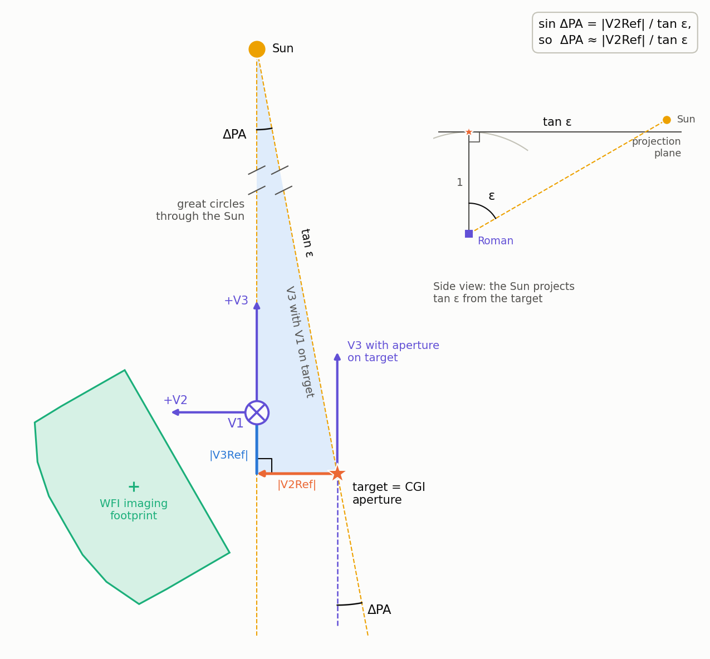

# Post-launch accuracy improvements to the `roman_pointing` attitude model

`roman_pointing` computes Roman's nominal attitude for a target as follows:

* `calcRomanAngles` points the boresight V1 at the target, with the Sun in the V1–V3 plane.
* The observatory is at the ideal Sun–Earth L2 point (`getL2Positions`).
* The Sun and target directions are evaluated in a zero-velocity coordinate frame.
* `getRomanPositionAngle` returns the PA of V3 about V1.

Three simplifications in this model each cause the CGI EXCAM position angle (PA_V3 and PA_APER) or Sun angle to deviate from reality by up to a few tenths of
a degree. This note describes optional features to account for each of these effects:

* **A. CGI aperture boresight on the target.** Operations place the CGI aperture boresight, 0.386° from V1, on the target, and quote PA_V3
  there. The aperture position comes from the Roman Science Instrument Aperture File ([SIAF](https://roman-docs.stsci.edu/simulation-tools/additional-simulation-tools/pysiaf-for-roman)).
* **B. Roman's actual position.** Roman orbits L2 at up to 840,000 km from it. The position comes from the
  [JPL Horizons](https://ssd.jpl.nasa.gov/horizons/) ephemeris.
* **C. Velocity aberration.** Roman moves at about 30 km/s, which displaces the apparent target and Sun directions by
  up to 21″. The attitude is solved from the apparent directions and then expressed in the barycentric coordinate frame.

All three are implemented in `roman_pointing`, with tests. With the new arguments left at their
defaults, every current output is unchanged. With all three enabled, the model reproduces the Roman SOC observation plans,
the attitude telemetry, and the CGI header pointing values of four commissioning visits to ≤ 0.004° (section 6).

## 1. Summary

| Feature | Implementation | Effect on PA_V3 and PA_APER | Effect on the FOR | Size in the flight verification data |
|---|---|---|---|---|
| A. Aperture boresight offset | `aperture=getSIAFAperture()` | ≈ V2Ref/tan ε; 0 at ε = 90°, ≤ 0.22° at the FOR edges | Sun angle of V1 = target's + V3Ref (−0.23°) | 0.006°–0.020° (ε ≈ 86°–92°) |
| B. Horizons ephemeris | `r_obs_G=getRomanPositions(ts)` | ≤ 0.33° (rms 0.16°), varying over months | Sun angle ≤ 0.30° (rms 0.15°) | 0.28°–0.30° |
| C. Velocity aberration | `v_obs_G=getRomanVelocities(ts)`, `removeAberration` | ≈ −8.3 min × dPA_V3/dt (Sun) plus ≤ 0.004° (target) | Sun angle ≤ 21″ | 0.005°–0.006° |

ε is the Sun angle of the target, and V2Ref, V3Ref are in radians.

* **B is usually the largest.** It varies with Roman's orbit over months and is the same for all targets on a date.
* **A depends on the Sun angle.** It vanishes at ε = 90° and dominates near the FOR edges.
* **C is the smallest,** but at 0.003°–0.009° it is still larger than the 0.001° rounding of the observation plans.

All three change the PA_V3 rate by ≲ 2%, so the analytic rate model in `field_rotation.py` remains valid as it is.

Verification against the Roman commissioning data (section 6). The residual is the Roman ground system planned PA_V3 (OPUP "CGI
Fixed v3pa@T") minus the model's nominal PA_V3 at the planned attitude epoch; the table gives its largest absolute
value over the three visits with plans.

| Model | Max \|ground system PA − roman_pointing PA\| |
|---|---|
| Previous baseline | 0.30° |
| Feature A only | 0.31° |
| Feature B only | 0.014° |
| Features A + B | 0.009° |
| Features A + B + C | 0.0035° |

## 2. Conventions

* **Body frame.** The rows of `B_C_I[:, :, t]` are the body axes b₁, b₂, b₃ (the observatory V1, V2, V3 axes) in
  inertial (BarycentricMeanEcliptic) coordinates. A SIAF aperture reference point is located by two angular
  coordinates, V2Ref and V3Ref. V2Ref is measured from b₁ toward b₂, and V3Ref from the b₁–b₂ plane toward b₃. The unit vector to the reference point in the body frame is

    u_B = (cos V2Ref cos V3Ref, sin V2Ref cos V3Ref, sin V3Ref),

  and its inertial direction is `B_C_I[:, :, t].T @ u_B`.
* **Barycentric coordinate frame and apparent frame.**
  * Coordinates and position angles in the observation plan products (i.e., CPGS XML files) and the WFI pointing metadata are in the barycentric coordinate frame and do not account for the velocity aberration experienced by the Roman spacecraft.
  * The CGI Level 1 file header pointing keywords (`RA_BORE`, `RA_APER`, `PA_V3`, `PA_APER`)
    describe the attitude in the apparent frame of the moving spacecraft.
  * The two frames differ by up to 21″ in position and 21″ × tan |Dec| in PA.
* **Which PA_V3.** CPGS and the plans quote PA_V3 at the aperture, i.e. the local direction of V3 at the target, in
  the barycentric coordinate frame. With an `aperture`, `getRomanPositionAngle(B_C_I, aperture)` returns this quantity.
  * With `aperture=None` it returns PA_V3 at V1, which differs by meridian convergence (up to 0.83° for |Dec| < 60°
    and 7.7° at |Dec| = 87°) and is useful only for diagnostics.
* **Field of regard.** The Sun-angle limits (54°–126°) apply to V1, because they are set by the illumination of the
  solar panels (normal +V3). They concern the physical, i.e. apparent, Sun direction. `calcRomanAngles` always returns
  the Sun angle of V1.
* **Attitude epoch.** An observation plan fixes PA_V3 for the planned attitude epoch (the start of the visit slew),
  and the attitude is then held inertially fixed. Comparisons with plans must use that epoch.

## 3. Feature A: CGI aperture on the target

### 3.1 Effect

The SIAF gives the calibrated aperture reference point:

| `CGI_CEN` (`roman_siaf_inflight_20261021.xml`) | Value |
|---|---|
| V2Ref, V3Ref | −1104.214″, −840.945″ |
| Offset from V1, δ | 0.3855° |
| Direction of offset | 52.7° from −V3 toward −V2 |
| V3IdlYAngle, VIdlParity | −30.13967°, −1 |
| Ideal-frame vertices | ±11.16″ |

The SIAF V2 and V3 axes are the body axes b₂ and b₃. Values below are for 400 random targets in the FOR on 2027-03-01, plus
the examples in [`docs/field_rotation_rate/README.md`](../field_rotation_rate/README.md).

* **Nominal roll and PA_V3.** Moving V1 so that the aperture lands on the target has two components:
  * The V3Ref part of the offset lies along the Sun–V1 great circle and only changes pitch.
  * The V2Ref part is perpendicular to it. Keeping the Sun in the V1–V3 plane then needs a roll of −V2Ref/tan ε.

  The PA_V3 at the target therefore changes by

    ΔPA ≈ V2Ref/tan ε − V2Ref·V3Ref, with V2Ref and V3Ref in units of radians.

  * The second term is a constant −0.00125°; the residual error of this approximation is < 10⁻⁶ deg.
  * |ΔPA| is 0 at ε = 90° and at most 0.22° at the FOR edges.
  * The rate changes by ≤ |V2Ref| λ̇☉/sin²ε ≈ 0.008°/day.

  

  *Made with `tools/boresight_offset_diagram.py`, for ε = 60°, with the focal-plane offsets exaggerated ×10. The sky*
  *around the target in a gnomonic projection (great circles are straight lines), in the body frame of the final*
  *attitude (+V3 up, +V2 left). The aperture's offset from V1 splits into a V3 part along V1's great circle to the Sun*
  *and a V2 part across it. At nominal roll, V3 points along the great circle to the Sun, so the PA change is the*
  *angle at which the great circles from V1 and from the target meet at the Sun. In the shaded right triangle*
  *In the shaded right triangle, the side opposite the Sun is |V2Ref| and the hypotenuse is tan ε, so sin ΔPA = |V2Ref|/tan ε.*

* **Field of regard.** V1 is displaced toward the Sun by V3Ref, so the Sun angle of V1 is the target's minus 0.234°.
  The target's FOR becomes 54.23° ≤ ε ≤ 126.23°, which moves the window edges by ≈ 0.24 day near the ecliptic.
* **Roll axis.** A 15° roll about V1 moves the target 362″ off the aperture, far outside the ±11″ EXCAM field, and
  changes the aperture PA by 14.7°–15.0°. A roll about the aperture axis keeps the target fixed and changes the
  aperture PA by exactly the roll.
  * The observatory's ±15° off-nominal roll limit applies to the roll about V1, i.e. the rotation of the Sun about V1
    away from the V1–V3 plane. `getRomanRollAngle(B_C_I, rhat_sun)` returns this angle.
  * A 15° roll about the aperture is a roll of 15.03°–15.05° about V1 at ε = 56°–60°, 15° at ε = 90°, and
    14.95°–14.97° at ε = 120°–124°. It also moves V1 around the aperture, changing the Sun angle of V1 by up to 0.09°.
  * `tools/plan_roll_limits.py` applies two roll limits and uses the stricter at each time: the observatory limit of
    ±15° about V1 (`ROLL_MAX_OBSERVATORY`; it finds the aperture rolls that give ±15° about V1), and a second
    constraint of ±15° about the aperture itself (`ROLL_MAX_INSTRUMENT`). The observatory limit binds sunward of
    quadrature (ε < 90°) and the instrument limit beyond it. The tool reports which limit sets each end of the
    allowed range, and the Sun angle of V1 at the limiting rolls.

### 3.2 Implementation

* **SIAF extract and reader.** The full SIAF release is 16 MB, almost all of it WFI SpecPars grids, and the public
  [pysiaf](https://github.com/spacetelescope/pysiaf) repository does not yet hold the commissioning SIAF.
  * `src/roman_pointing/siaf/roman_siaf_inflight_20261021_CGI.xml` is a 4 kB copy of the release header and its CGI
    `SiafEntry` blocks, made with `tools/extract_siaf_cgi.py`, and packaged via `[tool.setuptools.package-data]`.
  * `getSIAFAperture(aper_name="CGI_CEN", siaf_file=SIAF_FILE)` returns `V2Ref`, `V3Ref`, `V3IdlYAngle`,
    `VIdlParity` and u_B. The keys match pysiaf's aperture attributes, so a later switch to
    `pysiaf.Siaf("Roman")[aper_name]` only changes this function.
  * Extracts must come from releases dated 20260928 or later. Earlier releases used a different ideal-frame
    convention (V3IdlYAngle ≈ 240°).
* **`calcRomanAngles(..., aperture=None)`.**
  * The two Sun-alignment rotations are unchanged. The yaw and pitch steps point b₁ at a direction that is
    iterated until the aperture lands on the target: `rhat_point += rhat_target − B_C_Iᵀ u_B`.
  * The iteration converges by ~10³ per pass (1388″ → 2–5″ → 0.01″ → numerical floor). It keeps the Sun in the
    V1–V3 plane; rotating the V1-on-target attitude rigidly onto the aperture would not.
  * `sun_ang`, `yaw` and `pitch` refer to V1.
* **`applyRollAngle(..., aperture=None)`.** Rolls about u_B with Rodrigues' formula, `angutils.calcDCM(u_B, -a)`.
  `calcDCM` returns the DCM in the opposite sense to `rotMat`, so `calcDCM([1, 0, 0], -a)` equals `rotMat(1, a)`
  and the sign convention carries over: a roll of +r lowers the aperture PA by r.
* **`getRomanPositionAngle(..., aperture=None)`.** Measures the PA about the aperture direction, projecting both north
  and b₃ onto the plane perpendicular to it. The projection of b₃ is the local +V3 direction at the aperture, the
  quantity pysiaf's `posangle` returns.
* **`getEXCAMPositionAngle(..., aperture=None)`.** Gives PA_APER = PA_V3 + V3IdlYAngle + 180° = PA_V3 + 149.86° for the 2026-10-21 CGI SIAF.

### 3.3 Tests (`tests/test_aperture_offset.py`)

* `aperture=None` reproduces the main branch to 10⁻⁹ deg. An aperture at V1 (u_B = e₁) reproduces
  the default attitude, roll and PA.
* For 25 targets across the FOR:
  * the aperture is on the target (< 10⁻⁹) and b₂·r̂_sun = 0;
  * the Sun angle of V1 minus the target's equals V3Ref to 10⁻³ deg;
  * ΔPA matches V2Ref/tan ε − V2Ref·V3Ref to 10⁻⁵ deg, which catches a sign or axis-convention error.
* A roll of r about the aperture keeps the target on it and changes the aperture PA by exactly −r.
* `getRomanRollAngle` is 0 at nominal and r after a roll of r about V1 (10⁻⁹ deg). A 15° roll about the aperture is
  within 0.05° of 15° about V1, larger for ε < 90° and smaller above, and the iteration of `plan_roll_limits.py` finds
  the aperture roll for ±15° about V1 to 10⁻⁸ deg. With the conservative aperture limit added, the stricter of the
  two limits is reached: the one about V1 for ε < 88° and the one about the aperture for ε > 92°.
* If pysiaf is installed (checked with 0.29.0): `pysiaf.utils.rotations.attitude` and `posangle` confirm the V2/V3
  axis and V3IdlYAngle conventions. For Roman, `pysiaf.Siaf` ignores `filename` unless `basepath` is also given.

## 4. Feature B: Roman's position from the JPL Horizons ephemeris

### 4.1 Effect

`getL2Positions` scales the Earth's barycentric position by the collinear L2 distance. Every Sun direction, Sun angle
and nominal attitude follows from this position. Roman's [Horizons](https://ssd.jpl.nasa.gov/horizons/) trajectory (`-211`) is available from 2026-08-30
to 2028-11-08 (as of 2026-11-11; NASA will extend and update it).

* **Position.** Roman is 290,000–840,000 km from the ideal L2 point, so the Sun direction differs by 0.06°–0.31°.
* **Sun angle and PA_V3.** For 400 random targets at random dates, the Sun angle differs by up to 0.30° (rms 0.15°)
  and the nominal PA_V3 by up to 0.33° (rms 0.16°).
* **Rates.** The offset changes by ≤ 0.012°/day, so PA_V3 rates change by ≲ 2% and the roll-offset limits by
  ≲ 0.1° over a 9-day span.
* **FOR edges.** The edges move by up to ~0.3 day near the ecliptic.

### 4.2 Implementation

The implementation follows the astroquery recipe of the [`roman_pointing_demo` notebook](https://github.com/roman-corgi/roman_pointing/blob/main/Notebooks/roman_pointing_demo.ipynb) ("Using a real Roman Orbit")
and the structure of the [EXOSIMS Roman observatory](https://github.com/dsavransky/EXOSIMS/blob/master/EXOSIMS/Observatory/Roman.py) (`EXOSIMS/Observatory/Roman.py`): a Horizons query, a cubic-spline
interpolant of the table, and its evaluation at the requested times.

* **`queryRomanOrbit(ts, step="1d")`** queries Horizons with astroquery,
  `Horizons(id="-211", location="@0", ...).vectors(refplane="earth")`, for one table spanning `ts`, padded by
  2 days. It takes about 1 s per call.
  * The times are TDB (Barycentric Dynamical Time, the uniform time scale of solar-system ephemerides, about
    UTC + 69 s in 2026), the time scale of Horizons vector tables.
* **`queryRomanOrbitSpan(start, stop, step)`** makes the query for `queryRomanOrbit`.
  * Its results are cached in memory for the Python session (`functools.lru_cache`), so tools that loop over targets
    with the same time span make one query. They are not cached on disk (astroquery's `cache=False`), because the
    Horizons trajectory of Roman is updated after orbit determination.
  * If the span extends beyond the Horizons coverage, it is clipped to the coverage edge reported in the Horizons
    error message ("No ephemeris … prior to/after A.D. …") and queried again.
* **`genRomanOrbitInterpolant(vectors_table)`** is the [EXOSIMS](https://github.com/dsavransky/EXOSIMS/blob/master/EXOSIMS/Observatory/Roman.py) function of that name: a `CubicSpline` over MJD, with
  the unit check. The table times are labeled TDB.
  * The spline is within 0.5 km of hourly Horizons values, and allows any `ts`, not only the daily table grid of the
    notebook.
* **`getRomanPositions(ts, step="1d")`** evaluates the interpolant and returns barycentric BarycentricMeanEcliptic
  positions (AU), the same form as `getL2Positions`, so the result can be passed as `r_obs_G`.
  * The query is for ICRF vectors, which are converted to ecliptic coordinates with astropy, as `getSunPositions`
    does. EXOSIMS and the notebook use Horizons' own ecliptic or equatorial planes instead; the difference is < 10 km.
* **`getRomanVelocities(ts, step="1d")`** returns the derivative of the same interpolant (km/s) and is used by feature C.
* **Fallback.** Without a network, both functions warn and return the L2 approximation. Times in `ts` outside the
  Horizons table (beyond the coverage) get the L2 approximation, with a warning, and the other times the Horizons
  orbit. A span that crosses the coverage edge, like a 2-year observability window, therefore uses Horizons where
  it can.

### 4.3 Tests (`tests/test_roman_ephemeris.py`; skipped when there is no network access)

* `getRomanPositions` lies 2–9 × 10⁵ km from `getL2Positions` within the coverage.
* `genRomanOrbitInterpolant` reproduces the table at its nodes, and gives the same result for a table in km.
* The daily spline agrees with hourly Horizons values to < 1 km.
* The Sun direction from Roman agrees with Horizons' Sun vector as seen from Roman to < 1″ (0.03″ achieved).
* `getRomanVelocities` agrees with finite differences of `getRomanPositions` to 10⁻³ km/s.
* Outside the coverage, the functions warn and return L2 values. For times on both sides of the coverage edges,
  only the times outside get L2 values.
* A repeated call for the same span uses the session cache.
* `pa_v3_drift` uses the Horizons orbit by default, and `ephemeris="L2"` the L2 point.
* The full model (A + B + C) reproduces the ground system planned PA_V3 to 0.005°. For the CGI-prime visits this is
  "CGI Fixed v3pa@T", which A + B alone misses by up to 0.009°. For the WFI-prime visits
  it is the V3PA at V1.

## 5. Feature C: Velocity aberration

### 5.1 Effect

Roman's barycentric velocity v displaces the apparent direction of every source toward the direction of motion by
(v/c) sin θ, where θ is the angle between the source and the velocity. The maximum, v/c at θ = 90°, is 20.3″–21.2″
for Roman's speed of 29.5–30.8 km/s. The nominal attitude is defined by two vectors, and both are seen in apparent
directions:

* the target, whose apparent image must be in the aperture;
* the Sun, which must be in the V1–V3 plane.

The physical attitude therefore follows from the aberrated target and Sun directions. The plans describe that same
attitude in the barycentric coordinate frame, by removing the aberration at the aperture.

* **Sun term.** The Sun's apparent longitude lags its geometric longitude by 20.3″–21.2″. This is the same as
  evaluating the nominal roll 8.3–8.5 min earlier (the light time from the Sun), ΔPA ≈ −8.4 min × dPA_V3/dt.
* **Target term.** Up to ≈ 21″/tan ε.
* **Frame of the result.** The apparent-frame PA_V3, as in the CGI headers, differs from the PA_V3 in the barycentric coordinate frame by up to 21″ × tan |Dec|.
* **Field of regard.** The apparent Sun angle differs from the geometric one by ≤ 21″ (0.006°), about 8–9 minutes of
  FOR-edge timing.

### 5.2 Implementation

* **`applyAberration(rhat, v_obs_G, inverse=False)`** implements the special-relativistic aberration of
  3×n unit vectors. With β = v/c and γ = (1 − β²)^(−1/2):

    r̂′ = [r̂/γ + β + γ/(1+γ) (r̂·β) β] / (1 + r̂·β),

  and `inverse=True` replaces β by −β (apparent → barycentric coordinate frame). To first order, r̂′ = r̂ + β − (r̂·β) r̂.
* **`getL2Velocities(ts)`** gives the velocity of the L2 approximation, by central differences. It is used with the
  default ephemeris.
* **`calcRomanAngles(..., v_obs_G=None)`.** If a velocity is given, the target and Sun directions are aberrated
  before the attitude solution. `B_C_I` is then the physical attitude (the frame of the quaternion), and `sun_ang`
  the apparent Sun angle.
* **`removeAberration(B_C_I, v_obs_G, aperture=None)`** rotates each attitude by the smallest rotation that moves the
  apparent direction of the reference point (aperture, or V1) to its catalog direction. `getRomanPositionAngle` of
  the result is the PA_V3 of the plans and CPGS, in the barycentric coordinate frame. This is the same convention as the WFI pipeline's
  pointing metadata.

### 5.3 Tests (`tests/test_aberration.py`, offline with L2 velocities)

* The shift has magnitude β sin θ and points toward the velocity, and the inverse round trip is exact (10⁻¹⁴).
* Zero velocity reproduces the default attitude exactly.
* With a velocity, the aperture is on the apparent target (< 10⁻⁹), the apparent Sun is in the V1–V3 plane, and
  `sun_ang` is the apparent Sun angle.
* `removeAberration` puts the aperture on the catalog target and agrees with an independent two-point transport of
  the PA to 10⁻⁶°.
* `pa_v3_drift(aberration=True)` changes the PA_V3 of a high-declination test target by the expected few 0.001° without changing the rate.

## 6. Verification against flight data

The model was checked against data files from commissioning activities in which
WFI and CGI took exposures at the same time. Several sets of quantities are
available for each of these visits. The Roman ground system observation plan
files give the planned attitude epoch, the planned PA_V3 at the target, V1 with
its PA_V3, and the roll from nominal during the visit. The CGI L1 headers give
the pointing in the apparent velocity-aberrated frame (`RA_BORE`, `DEC_BORE`,
`RA_APER`, `DEC_APER`, `PA_V3`, `PA_APER`). The WFI metadata give the
telemetry-based attitude in the barycentric coordinate frame, the raw attitude
quaternion (apparent frame), the predicted spacecraft ephemeris, and the
alignment of the WFI image to Gaia stars. The script `tools/compare_flight_metadata.py`
computes the nominal attitude at the planned epoch for each combination of
features A, B and C, and compares it with each of these values: the planned
PA_V3 and roll, the header pointing, the telemetry PA_V3, the raw quaternion
with and without the aberration removed (at the WFI target aperture), and the
WFI ephemeris. For visits where WFI is prime, the comparison is made at the WFI
aperture on the target.

With all three features applied, roman_pointing reproduces the planned PA_V3 of
the CGI-prime visits with plans to ≤ 0.0035° at the planned attitude epoch, and
the PA_V3 from the attitude telemetry and the CGI headers of the CGI-prime
visits to ≤ 0.004°; the previous baseline roman_pointing model differs from the
plans by 0.27°–0.30°. For these dates, feature B removes most of that error
(0.28°–0.30°), feature A removes 0.006°–0.020° (small because the targets are
near ε = 90°), and feature C removes a remaining 0.005°–0.006°.

The CGI header values `RA_BORE`, `DEC_BORE`, and `PA_V3` are consistent with the
attitude quaternions recorded in the WFI files to ≤ 0.2″ and 6 × 10⁻⁵ deg
(apparent frame). After the velocity aberration is removed, the same CGI header
values match the barycentric pointing metadata in the WFI files to ≤ 0.04″ and
10⁻⁵ deg.

The ephemeris in the WFI metadata match `getRomanPositions` to 116 km and
`getRomanVelocities` to < 10⁻⁴ km/s. The model's roll from nominal grows at the
OPUP's rate over each visit, and given the plan's PA_V3, the model predicts the
PA_V3 at V1 in the telemetry during execution to ≤ 0.0007°.

Roman CPP team members can read a longer description of the comparisons between
the roman_pointing model and the flight data on the CPP Confluence wiki page 
<i>Spacecraft attitude model verification with WFI+CGI parallel metadata</i> in the
Commissioning Analysis area.

## 7. Interfaces and scope

With all three features applied, the nominal PA_V3 determined by the ground system can be computed as follows:

```python
aperture = getSIAFAperture()                                         # A
r_obs_G, v_obs_G = getRomanPositions(ts), getRomanVelocities(ts)     # B (and the velocity for C)
sun_ang, yaw, pitch, B_C_I = calcRomanAngles(target, ts, r_obs_G, aperture=aperture, v_obs_G=v_obs_G)   # C
pa_v3 = getRomanPositionAngle(removeAberration(B_C_I, v_obs_G, aperture), aperture)
```

* **`field_rotation.pa_v3_drift(ra, dec, t_mid, dt, aperture="CGI_CEN", ephemeris="horizons", aberration=False)`**
  does the same for a range of times, with A and B by default (`aperture` takes a SIAF aperture name, an aperture
  from `getSIAFAperture()`, or `None` for V1). Its `sun_ang` is always that of V1, so the FOR checks against `SUN_ANG_MIN`/`SUN_ANG_MAX`
  remain correct.
* **`tools/plan_roll_limits.py`** uses `--aperture CGI_CEN --ephemeris horizons` by default; add `--aberration` for C,
  or use `--aperture none --ephemeris L2` for the boresight model. The reported PA_V3 is then the quantity CPGS uses,
  and the roll-offset arithmetic (a roll of +r changes PA by −r) is exact at the EXCAM aperture. In the worked examples of
  the field-rotation README the defaults change the roll limits by ≤ 0.03° and the reachable PAs by 0.2°–0.6°. The
  roll is limited to ±15° both about V1 and, conservatively, about the aperture (section 3.1).
* **The analytic functions** in `field_rotation.py` (`pa_v3_rate`, `for_window`, `fixed_pa_window`, …) remain
  boresight models. 
* **Planning tools apply features A and B by default.** These have new arguments `aperture="CGI_CEN"` (`None` for V1) and
  `ephemeris="horizons"` (`"L2"` for the L2 point), with aberration off. They are offline-tested in
  `tests/test_planning_defaults.py`.
  * `roman_excam_planner.py` (`calculate_roman_EXCAMangles`, `compute_angles`). The PA_V3 and PA_APER are measured
    at the aperture, with PA_APER = PA_V3 + V3IdlYAngle + 180°, and the roll is about the instrument aperture. In a test case
    (June 2027) PA_APER changes by 0.22°–0.55°.
  * `roman_observability.py` (`compute_roman_angles`, `compute_keepout`), and through it
    `Reference_Star_Selection_Tool.py`. The Sun angle and pitch are those of V1 with the aperture on the target.
    Over 2 years at 1-day steps, the observable days of five test targets change by ≤ 3.
  * `drive_cpgs.py` (`find_crossing_time_diff`), which compares FOR crossing times with CPGS. Aberration, left off,
    can still move a crossing by up to ~9 min (section 5.1).
  * `tools/zero_pitch_targets.py` (`--aperture`, `--ephemeris`). The Simbad search circles follow the track of the
    aperture at zero V1 pitch. 
* **Not changed:** `slewing.py`, because the options change the yaw and pitch differences between targets by
  ≤ 0.25°, a negligible fraction of a slew; and `tools/field_rotation_rate.py`, which validates the analytic V1-at-L2
  model (the aperture term V2Ref/tan ε is not part of it). The notebooks that call `calcRomanAngles` directly are
  also unchanged.
* **Dependencies:** none new. `angutils.calcDCM`, `scipy.interpolate.CubicSpline`, `astroquery.jplhorizons` and
  the standard-library `xml.etree` are used. `asdf` is needed only for `compare_flight_metadata.py --wfi`.

## 8. Open items

* **Future SIAF updates.** When a new SIAF release arrives, regenerate the extract, update `SIAF_FILE`, and remove the
  previous extract.
  * During science operations, the most recent SIAF will be synced to the public pysiaf repo. It will then be possible to modify `getSIAFAperture` to import the aperture offset and orientation data directly from pysiaf (https://github.com/spacetelescope/pysiaf).       