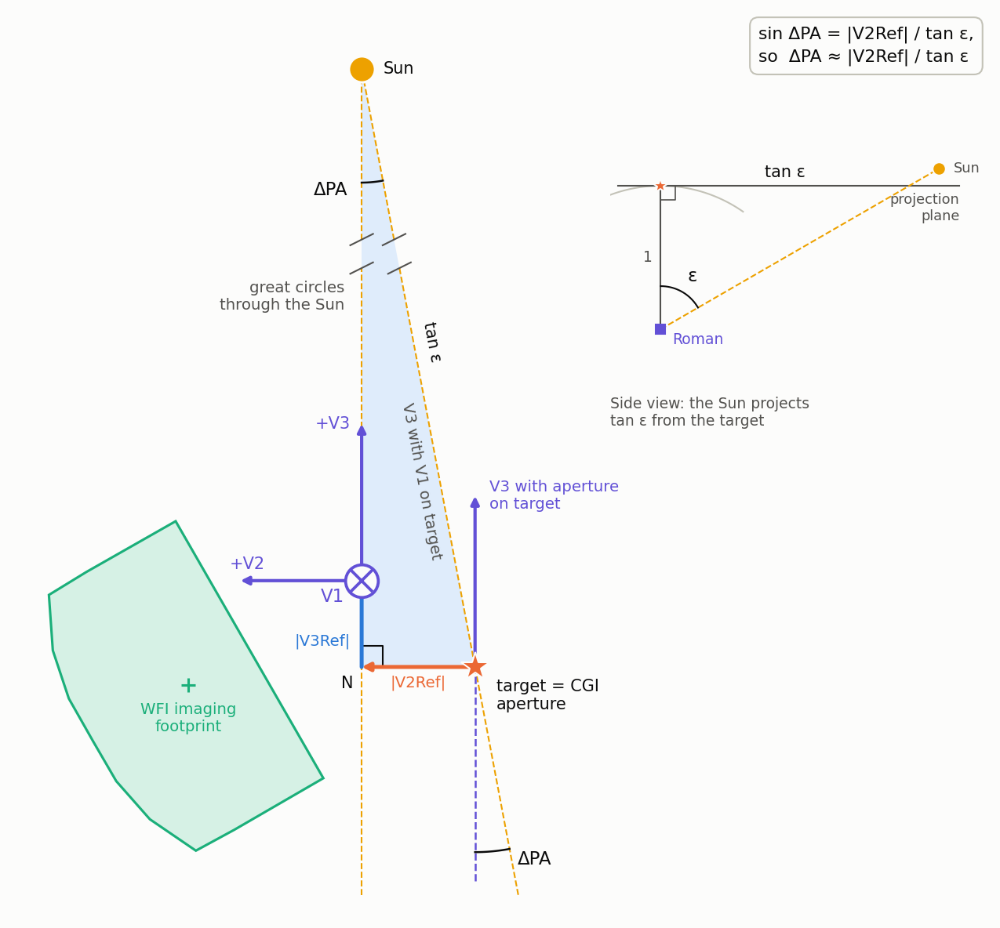

# Optional accuracy improvements to the `roman_pointing` attitude model

`roman_pointing` computes Roman's nominal attitude for a target as follows:

* `calcRomanAngles` points the boresight V1 at the target, with the Sun in the V1–V3 plane.
* The observatory is at the ideal Sun–Earth L2 point (`getL2Positions`).
* The Sun and target directions are geometric.
* `getRomanPositionAngle` returns the PA of V3 about V1.

Three simplifications in this model each change Roman's position angle (PA_V3) or Sun angle by up to a few tenths of
a degree. This note describes one opt-in change for each:

* **A. CGI aperture on the target.** Operations place the CGI aperture, 0.386° from V1, on the target, and quote PA_V3
  there. The aperture position comes from the Roman SIAF.
* **B. Roman's actual position.** Roman orbits L2 at up to 840,000 km from it. The position comes from the JPL
  Horizons ephemeris.
* **C. Velocity aberration.** Roman moves at about 30 km/s, which displaces the apparent target and Sun directions by
  up to 20.6″. The attitude is solved from the apparent directions and then expressed in the catalog frame.

All three are implemented in `roman_pointing`, with tests. With the new arguments left at their
defaults, every current output is unchanged. With all three enabled, the model reproduces the Roman SOC observation plans,
the attitude telemetry and the CGI header pointing of five commissioning visits to ≤ 0.004° (section 6).

## 1. Summary

| Change | Option | Effect on PA_V3 | Effect on the FOR | Size in the flight-data visits |
|---|---|---|---|---|
| A. Aperture offset | `aperture=getSIAFAperture()` | V2Ref/tan ε − V2Ref·V3Ref: 0 at ε = 90°, ≤ 0.22° at the FOR edges | Sun angle of V1 = target's + V3Ref (−0.234°) | 0.006°–0.020° (ε ≈ 86°–92°) |
| B. Horizons ephemeris | `r_obs_G=getRomanPositions(ts)` | ≤ 0.33° (rms 0.16°), varying over months | Sun angle ≤ 0.30° (rms 0.15°) | 0.28°–0.30° |
| C. Velocity aberration | `v_obs_G=getRomanVelocities(ts)`, then `removeAberration` | ≈ −8.3 min × dPA_V3/dt (Sun) plus ≤ 0.004° (target) | Sun angle ≤ 20.6″ | 0.005°–0.006° |

ε is the Sun angle of the target, and V2Ref, V3Ref are in radians.

* **B is usually the largest.** It varies with Roman's orbit over months and is the same for all targets on a date.
* **A depends on the Sun angle.** It vanishes at ε = 90° and dominates near the FOR edges.
* **C is the smallest,** but at 0.003°–0.009° it is still larger than the 0.001° rounding of the observation plans.

All three change the PA_V3 rate by ≲ 2%, so the analytic rate model in `field_rotation.py` remains valid as it is.

Verification against the Roman SOC observation plans (section 6.3, Table 1). The residual is the planned PA_V3 (OPUP "CGI
Fixed v3pa@T") minus the model's nominal PA_V3 at the planned attitude epoch; the table gives its largest absolute
value over the three visits with plans.

| Model | Max \|planned − model\| |
|---|---|
| Default (V1, L2, geometric) | 0.30° |
| A only | 0.31° |
| B only | 0.014° |
| A + B | 0.009° |
| A + B + C | 0.0035° |

## 2. Conventions

* **Body frame.** The rows of `B_C_I[:, :, t]` are the body axes b₁, b₂, b₃ (V1, V2, V3) in inertial
  (BarycentricMeanEcliptic) coordinates. The unit vector to an aperture reference point in the body frame is
  u_B = (cos V2 cos V3, sin V2 cos V3, sin V3), and its inertial direction is `B_C_I[:, :, t].T @ u_B`.
* **Catalog and apparent frames.**
  * Directions in a catalog, in the observation plans (OPUP, CPGS) and in the WFI pointing metadata are
    aberration-free: the catalog frame.
  * The attitude quaternion and the CGI L1 header pointing keywords (`RA_BORE`, `RA_APER`, `PA_V3`, `PA_APER`)
    describe the same attitude in the apparent frame of the moving observatory (section 6.2).
  * The two frames differ by up to 20.6″ in position and 20.6″ × tan |Dec| in PA.
* **Which PA_V3.** CPGS and the plans quote PA_V3 at the aperture, i.e. the local direction of V3 at the target, in
  the catalog frame. With an `aperture`, `getRomanPositionAngle(B_C_I, aperture)` returns this quantity.
  * With `aperture=None` it returns PA_V3 at V1, which differs by meridian convergence (up to 0.83° for |Dec| < 60°
    and 7.7° at |Dec| = 87°) and is useful only for diagnostics.
* **Field of regard.** The Sun-angle limits (54°–126°) apply to V1, because they are set by the illumination of the
  solar panels (normal +V3). They concern the physical, i.e. apparent, Sun direction. `calcRomanAngles` always returns
  the Sun angle of V1.
* **Attitude epoch.** An observation plan fixes PA_V3 for the planned attitude epoch (the start of the visit slew),
  and the attitude is then held inertially fixed. Comparisons with plans must use that epoch (section 6.2).

## 3. Change A: CGI aperture on the target

### 3.1 Effect

The SIAF gives the calibrated aperture reference point:

| `CGI_CEN` (`roman_siaf_inflight_20261021.xml`) | Value |
|---|---|
| V2Ref, V3Ref | −1104.214″, −840.945″ |
| Offset from V1, δ | 0.3855° |
| Direction of offset | 52.7° from −V3 toward −V2 (lower right in the observatory field-of-view diagram) |
| V3IdlYAngle, VIdlParity | −30.13967°, −1 |
| Ideal-frame vertices | ±11.16″ |

SIAF V2 and V3 are the body axes b₂ and b₃. Values below are for 400 random targets in the FOR on 2027-03-01, plus
the examples in [`docs/field_rotation_rate/README.md`](../field_rotation_rate/README.md).

* **Nominal roll and PA_V3.** Moving V1 so that the aperture lands on the target has two components:
  * The V3 component lies along the Sun–V1 great circle and only changes pitch.
  * The V2 component is perpendicular to it. Keeping the Sun in the V1–V3 plane then needs a roll of −V2Ref/tan ε.

  The PA_V3 at the target therefore changes by

    ΔPA ≈ V2Ref/tan ε − V2Ref·V3Ref.

  * Against the implementation the fit slope is 1.0000, and the residual is < 10⁻⁶°. The second term is a constant
    −0.00125°.
  * |ΔPA| is 0 at ε = 90° and at most 0.22° at the FOR edges, independent of declination: +0.06° to +0.09° for ε Eri
    (Jan 19–25, 2027) and +0.20° for HIP 71618 (ε ≈ 122°).
  * The rate changes by ≤ |V2Ref| λ̇☉/sin²ε ≈ 0.008°/day, ≤ 0.07° over a 9-day execution span.

  

  *Made with `tools/boresight_offset_diagram.py`, for ε = 60°, with the focal-plane offsets exaggerated ×10. The sky*
  *around the target in a gnomonic projection (great circles are straight lines), in the body frame of the final*
  *attitude (+V3 up, +V2 left). The aperture's offset from V1 splits into a V3 part along V1's great circle to the Sun*
  *and a V2 part across it. At nominal roll, V3 points along the great circle to the Sun, so the PA change is the*
  *angle at which the great circles from V1 and from the target meet at the Sun. In the shaded right triangle*
  *T–N–Sun, the side opposite the Sun is |V2Ref| and the hypotenuse is tan ε, so sin ΔPA = |V2Ref|/tan ε.*

* **Field of regard.** V1 is displaced toward the Sun by V3Ref, so the Sun angle of V1 is the target's minus 0.234°.
  The target's FOR becomes 54.23° ≤ ε ≤ 126.23°, which moves the window edges by ≈ 0.24 day near the ecliptic.
* **Roll axis.** A 15° roll about V1 moves the target 362″ off the aperture, far outside the ±11″ EXCAM field, and
  changes the aperture PA by 14.7°–15.0°. A roll about the aperture axis keeps the target fixed and changes the
  aperture PA by exactly the roll. The Sun-relative roll then differs from it by ≤ 0.05°, and V1's Sun angle by
  ≤ 0.07°.

### 3.2 Implementation

* **SIAF extract and reader.** The full SIAF release is 16 MB, almost all of it WFI SpecPars grids, and the public
  pysiaf repository does not yet hold the commissioning SIAF.
  * `src/roman_pointing/siaf/roman_siaf_inflight_20261021_CGI.xml` is a 4 kB copy of the release header and its CGI
    `SiafEntry` blocks, made with `tools/extract_siaf_cgi.py`, and packaged via `[tool.setuptools.package-data]`.
  * `getSIAFAperture(aper_name="CGI_CEN", siaf_file=SIAF_FILE)` returns `V2Ref`, `V3Ref`, `V3IdlYAngle`,
    `VIdlParity` and u_B. The keys match pysiaf's aperture attributes, so a later switch to
    `pysiaf.Siaf("Roman")[aper_name]` only changes this function.
  * Extracts must come from releases dated 20260928 or later. Earlier releases used a different ideal-frame
    convention (V3IdlYAngle ≈ 240°).
* **`calcRomanAngles(..., aperture=None)`.**
  * The two Sun-alignment rotations are unchanged. The yaw and pitch steps point b₁ at a direction that is
    iterated until the aperture lands on the target: `rhat_point += rhat_target − B_C_Iᵀ u_B`.
  * The iteration converges by ~10³ per pass (1388″ → 2–5″ → 0.01″ → numerical floor). It keeps the Sun in the
    V1–V3 plane; rotating the V1-on-target attitude rigidly onto the aperture would not.
  * `sun_ang`, `yaw` and `pitch` refer to V1.
* **`applyRollAngle(..., aperture=None)`.** Rolls about u_B with Rodrigues' formula, `angutils.calcDCM(u_B, -a)`.
  `calcDCM` returns the DCM in the opposite sense to `rotMat`, so `calcDCM([1, 0, 0], -a)` equals `rotMat(1, a)`
  and the sign convention carries over: a roll of +r lowers the aperture PA by r.
* **`getRomanPositionAngle(..., aperture=None)`.** Measures the PA about the aperture direction, projecting both north
  and b₃ onto the plane perpendicular to it. The projection of b₃ is the local +V3 direction at the aperture, the
  quantity pysiaf's `posangle` returns.
* **`getEXCAMPositionAngle(..., aperture=None)`.** Gives PA_APER = PA_V3 + V3IdlYAngle + 180° = PA_V3 + 149.86°,
  instead of the hard-coded 150°. CGI LOS_Y is EXCAM −Y by definition.

### 3.3 Tests (`tests/test_aperture_offset.py`)

* `aperture=None` reproduces the main branch to 10⁻⁹° (regression values). An aperture at V1 (u_B = e₁) reproduces
  the default attitude, roll and PA.
* The packaged extract has the current ideal-frame convention (|V3IdlYAngle + 30°| < 1°).
* For 25 targets across the FOR:
  * the aperture is on the target (< 10⁻⁹) and b₂·r̂_sun = 0;
  * the Sun angle of V1 minus the target's equals V3Ref to 10⁻³°;
  * ΔPA matches V2Ref/tan ε − V2Ref·V3Ref to 10⁻⁵°, which catches a sign or axis-convention error.
* A roll of r about the aperture keeps the target on it and changes the aperture PA by exactly −r.
* If pysiaf is installed (checked with 0.29.0): `pysiaf.utils.rotations.attitude` and `posangle` confirm the V2/V3
  axis and V3IdlYAngle conventions. For Roman, `pysiaf.Siaf` ignores `filename` unless `basepath` is also given.

## 4. Change B: Roman's position from the JPL Horizons ephemeris

### 4.1 Effect

`getL2Positions` scales the Earth's barycentric position by the collinear L2 distance. Every Sun direction, Sun angle
and nominal attitude follows from this position. Roman's Horizons trajectory (`-211`) is available from 2026-08-30
to 2028-11-08 (as of 2026-11-11; JPL extends and updates it).

* **Position.** Roman is 290,000–840,000 km from the ideal L2 point, so the Sun direction differs by 0.06°–0.31°.
* **Sun angle and PA_V3.** For 400 random targets at random dates, the Sun angle differs by up to 0.30° (rms 0.15°)
  and the nominal PA_V3 by up to 0.33° (rms 0.16°).
* **Rates.** The offset changes by ≤ 0.012°/day, so PA_V3 rates change by ≲ 2% and the roll-offset limits by
  ≲ 0.1° over a 9-day span.
* **FOR edges.** The edges move by up to ~0.3 day near the ecliptic.

For comparison, roman-opup-tools queries Horizons for the Sun as seen from Roman, once per epoch, and converts the
ecliptic vector with a fixed obliquity.

### 4.2 Implementation

The implementation follows the astroquery recipe of the `roman_pointing_demo` notebook ("Using a real Roman Orbit")
and the structure of the EXOSIMS Roman observatory (`EXOSIMS/Observatory/Roman.py`): a Horizons query, a cubic-spline
interpolant of the table, and its evaluation at the requested times.

* **`queryRomanOrbit(ts, step="1d")`** queries Horizons with astroquery,
  `Horizons(id="-211", location="@0", ...).vectors(refplane="earth")`, for one table spanning `ts`, padded by
  2 days. It takes about 1 s per call.
  * The times are TDB, the time scale of Horizons vector tables. Passing UTC strings, as the notebook does, shifts the
    positions by 69 s, about 2,100 km: 0.8″ in Sun angle and 2.8″ in PA_V3 for 11 UMi.
* **`queryRomanOrbitSpan(start, stop, step)`** makes the query for `queryRomanOrbit`.
  * Its results are cached in memory for the Python session (`functools.lru_cache`), so tools that loop over targets
    with the same time span make one query. They are not cached on disk (astroquery's `cache=False`), because the
    Horizons trajectory of Roman is updated after orbit determination.
  * If the span extends beyond the Horizons coverage, it is clipped to the coverage edge reported in the Horizons
    error message ("No ephemeris … prior to/after A.D. …") and queried again.
* **`genRomanOrbitInterpolant(vectors_table)`** is the EXOSIMS function of that name: a `CubicSpline` over MJD, with
  the unit check. The table times are labeled TDB.
  * The spline is within 0.5 km of hourly Horizons values, and allows any `ts`, not only the daily table grid of the
    notebook.
* **`getRomanPositions(ts, step="1d")`** evaluates the interpolant and returns barycentric BarycentricMeanEcliptic
  positions (AU), the same form as `getL2Positions`, so the result can be passed as `r_obs_G`.
  * The query is for ICRF vectors, which are converted to ecliptic coordinates with astropy, as `getSunPositions`
    does. EXOSIMS and the notebook use Horizons' own ecliptic or equatorial planes instead; the difference is < 10 km.
* **`getRomanVelocities(ts, step="1d")`** returns the derivative of the same interpolant (km/s) and is used by change C.
* **Fallback.** Without a network, both functions warn and return the L2 approximation. Times in `ts` outside the
  Horizons table (beyond the coverage) get the L2 approximation, with a warning, and the other times the Horizons
  orbit. A span that crosses the coverage edge, like a 2-year observability window, therefore uses Horizons where
  it can.
* **Not yet done.** A reader for the FDF OEM predicts used by the SOC would be an offline alternative. Each OEM file
  covers only weeks, so Horizons is the better default.

### 4.3 Tests (`tests/test_roman_ephemeris.py`; network, skipped when offline)

* `getRomanPositions` lies 2–9 × 10⁵ km from `getL2Positions` within the coverage.
* `genRomanOrbitInterpolant` reproduces the table at its nodes, and gives the same result for a table in km.
* The daily spline agrees with hourly Horizons values to < 1 km.
* The Sun direction from Roman agrees with Horizons' Sun vector as seen from Roman to < 1″ (0.03″ achieved).
* `getRomanVelocities` agrees with finite differences of `getRomanPositions` to 10⁻³ km/s.
* Outside the coverage, the functions warn and return L2 values. For times on both sides of the coverage edges,
  only the times outside get L2 values.
* A repeated call for the same span uses the session cache.
* `pa_v3_drift` uses the Horizons orbit by default, and `ephemeris="L2"` the L2 point.

## 5. Change C: velocity aberration

### 5.1 Effect

Roman's barycentric velocity displaces the apparent direction of every source toward the direction of motion, by up
to v/c = 20.6″. The nominal attitude is defined by two vectors, and both are seen in apparent directions:

* the target, whose apparent image must be in the aperture;
* the Sun, which must be in the V1–V3 plane.

The physical attitude therefore follows from the aberrated target and Sun directions. The plans describe that same
attitude in the catalog frame, by removing the aberration at the aperture.

* **Sun term.** The Sun's apparent longitude lags its geometric longitude by 20.5″. This is the same as evaluating
  the nominal roll 8.3 min earlier, ΔPA ≈ −8.3 min × dPA_V3/dt, i.e. 0.003°–0.009° for typical rates. Its sign
  follows the rate, so it flips between the ecliptic hemispheres.
* **Target term.** Up to ≈ 20.6″/tan ε. For 120 random targets in the FOR: ≤ 0.004° at ε = 54°–60° and 120°–126°,
  and ≤ 0.0014° at 75°–105°.
* **Frame of the result.** The apparent-frame PA_V3, as in the CGI headers, differs from the catalog-frame PA_V3 by
  up to 20.6″ × tan |Dec|: 0.010° at 60°, 0.032° at 80° and 0.065° at 85°.
* **Field of regard.** The apparent Sun angle differs from the geometric one by ≤ 20.6″ (0.006°), about 9 minutes of
  FOR-edge timing.

### 5.2 Implementation

* **`applyAberration(rhat, v_obs_G, inverse=False)`** implements the exact (special-relativistic) aberration of
  3×n unit vectors. With β = v/c and γ = (1 − β²)^(−1/2):

    r̂′ = [r̂/γ + β + γ/(1+γ) (r̂·β) β] / (1 + r̂·β),

  and `inverse=True` replaces β by −β (apparent → catalog). To first order, r̂′ = r̂ + β − (r̂·β) r̂.
* **`getL2Velocities(ts)`** gives the velocity of the L2 approximation, by central differences. It is used with the
  default ephemeris.
* **`calcRomanAngles(..., v_obs_G=None)`.** If a velocity is given, the target and Sun directions are aberrated
  before the attitude solution. `B_C_I` is then the physical attitude (the frame of the quaternion), and `sun_ang`
  the apparent Sun angle.
* **`removeAberration(B_C_I, v_obs_G, aperture=None)`** rotates each attitude by the smallest rotation that moves the
  apparent direction of the reference point (aperture, or V1) to its catalog direction. `getRomanPositionAngle` of
  the result is the catalog-frame PA_V3 of the plans and CPGS. This is the same convention as the WFI pipeline's
  pointing metadata.

### 5.3 Tests (`tests/test_aberration.py`, offline with L2 velocities)

* The shift has magnitude β sin θ and points toward the velocity, and the inverse round trip is exact (10⁻¹⁴).
* Zero velocity reproduces the default attitude exactly.
* With a velocity, the aperture is on the apparent target (< 10⁻⁹), the apparent Sun is in the V1–V3 plane, and
  `sun_ang` is the apparent Sun angle.
* `removeAberration` puts the aperture on the catalog target and agrees with an independent two-point transport of
  the PA to 10⁻⁶°.
* `pa_v3_drift(aberration=True)` changes the 11 UMi PA_V3 by the expected few 0.001° without changing the rate.
* Network: the OPUP regression of section 6.3, to 0.005°, is in `tests/test_roman_ephemeris.py`.

## 6. Verification with flight data

### 6.1 Data

| Visit | Date (2026) | Target | CGI L1/L2b (CDMS) | WFI parallel (`_wcs.asdf`) | Planned attitude epoch |
|---|---|---|---|---|---|
| CAR-55.1 | Oct 18 | LMC field (80.5525°, −69.5134°) | `0115601001001001001` (515) | `0103201001001001001` | 291/04:44:00 |
| CAR-55.4 | Oct 22 | LMC field | `0115601002001001001` (520) | `0103202002001001001` | 295/07:03:46 |
| CAR-102.7 | Oct 25 | n/a | `0110701003002001001` (520) | — | 298/12:04 (Jira) |
| CAR-101.1 | Oct 26 | n/a | `0110601001002001001` (520) | — | 299/20:45 (Jira) |
| CAR-193.1 | Nov 1 | 11 UMi (229.2745°, +71.8239°) | `0116001001001001001` (521) | `0104001001001001001` | 305/04:57:00 |

* **CGI:** L1 files from MAST (`roman_cgi`). For CAR-102.7, CAR-101.1 and two late CAR-193.1 frames, L2b files
  produced by the CGI DRP from the L1 files were used; they carry the same primary-header pointing keywords.
* **WFI:** `_wcs.asdf` files from MAST (`roman`), 49 kB each. They contain:
  * `meta.pointing`: `ra_v1`, `dec_v1` and `pa_v3` are `CALCULATED`, i.e. from the attitude telemetry. `quaternion`
    is the raw ACS attitude quaternion `SCF_AC_SDR_QBJ` at mid-exposure (scalar last, ICRS to body).
  * `meta.ephemeris`: the predicted spacecraft state.
  * `meta.wcs_fit_results`: the alignment of the WFI image to Gaia stars.

  The 209 MB `_uncal.asdf` of CAR-193.1 exposure 0004 has the same metadata and is not needed.
* **Retrieving the files.** Search MAST (https://mast.stsci.edu/search/ui/#/roman) by the visit IDs above: the
  `roman_cgi` collection for CGI and the `roman` collection for WFI. Commissioning data may still be in their
  exclusive-access period, which needs a MAST token. The files used:

  | Visit | CGI files (`cgi_<visit ID>_<time>_<level>.fits`) | WFI files |
  |---|---|---|
  | CAR-55.1 | `…_20261018t0532019_l1_` | `r0103201001001001001_0003_wfi01_f129_wcs.asdf` |
  | CAR-55.4 | `…_20261022t0739286_l1_` | `r0103202002001001001_0002_wfi01_f129_wcs.asdf` |
  | CAR-102.7 | `…_20261025t1452128_l2b`, `…_20261025t1452221_l2b` | — |
  | CAR-101.1 | `…_20261026t1828419_l2b`, `…_20261026t1853167_l2b`, `…_20261026t1917119_l2b` | — |
  | CAR-193.1 | `…_20261101t0051382_l1_`, `…_20261101t0101510_l1_`, `…_20261101t0107434_l1_` (first, middle and last of the 27 frames during the WFI parallel); `…_20261101t0145004_l2b`, `…_20261101t0148104_l2b` | `r0104001001001001001_0004_wfi01_f129_wcs.asdf`, `r0104001001001001001_0013_wfi01_f129_wcs.asdf` |
* **Plans:** STScI OPUP Product Delivery Notices (RSC Confluence) give the visit-slew and visit-begin times, "CGI
  Fixed v3pa@T" (PA_V3 at the target, catalog frame), V1 and the roll from nominal. The Jira TSRs (ROMCOM-369, -393,
  -416, -417, -426) give the planned and actual execution times.

### 6.2 Conventions established

* **Attitude epoch.** The plan fixes PA_V3 at the start of the visit slew. This is also the Jira "Planned Execution
  Time", except for CAR-55.4 (Jira 06:58).
  * The OPUP roll grows at the Sun's rate from about 0 at that epoch.
  * The attitude is held inertially fixed when the visit executes at another time: here between 4.4 h early
    (CAR-193.1) and 22 min late (CAR-55.1).
* **Frames (change C).**
  * The CGI L1 pointing keywords equal the raw ACS attitude quaternion (`SCF_AC_SDR_QBJ`, carried in the WFI
    metadata) to 0.07″–0.19″ and 5 × 10⁻⁵° (Table 4).
  * WFI `meta.pointing` is the same quaternion with the aberration removed (0.02″–0.08″, 7 × 10⁻⁵°), and agrees
    with the OPUP V1 and V3PA to their rounding.
  * The Gaia alignment of the WFI images changes the orientation by only 0.002°.
  * The two frames differ by 20.2″–20.7″ in position, and by Δα sin δ in PA: −0.0166° for 11 UMi and −0.0085° to
    −0.0094° for the LMC field.
* **Aperture (change A).**
  * The header PA_V3 is the local PA_V3 at the aperture: the attitude defined by the header boresight and aperture
    positions reproduces it to < 10⁻⁴°.
  * The 20261021 SIAF CGI_CEN is in the aberration-corrected frame. SSC's star-matched EXCAM centre, converted with
    the aberration-corrected WFI attitude, gives V2/V3 within 0.01″ of it for CAR-55.1 (the data used for the
    update), and within 0.04″ for CAR-55.4 (after the release). Without the correction both would differ by 20.6″.
  * CDMS 515 headers (CAR-55.1) were computed with the preflight SIAF: `RA_APER` is 204″ from the star-matched centre,
    and `PA_APER` = `PA_V3` + 150°.
* **Ephemeris (change B).** The WFI `meta.ephemeris` (predicted, EME2000) matches `getRomanPositions` to 116 km, and
  `getRomanVelocities` to < 10⁻⁴ km/s.

### 6.3 Results

Symbols used in the tables:

| Symbol | Meaning |
|---|---|
| t₀ | Planned attitude epoch (section 6.1) |
| t | A time during the visit (visit begin, visit end, or a WFI mid-exposure time) |
| PA_plan | OPUP "CGI Fixed v3pa@T": the PA_V3 at the target that the plan commands and holds for the whole visit (catalog frame) |
| PA_nom(t) | `roman_pointing` model: PA_V3 at the target of the nominal attitude at time t (catalog frame unless stated) |
| R(t) = PA_nom(t) − PA_plan | Roll from nominal at time t, in the sign convention of `applyRollAngle` (a roll of +r lowers PA_V3 by r) |
| PA_hdr | CGI header `PA_V3` (apparent frame) |
| PA_tel | PA_V3 at CGI_CEN from the WFI attitude telemetry, `meta.pointing` (catalog frame) |
| PA_tel,V1 | PA_V3 as the WFI telemetry reports it, `meta.pointing.pa_v3`, which refers to V1 (catalog frame) |
| PA_pred,V1(t) | `roman_pointing` prediction of PA_tel,V1 from t, PA_plan and the SIAF CGI_CEN offset (Table 3) |

**Table 1. Planned PA_V3: residual PA_plan − PA_nom(t₀), for each model.** A residual of 0 means the model reproduces
the plan. PA_nom from `pa_v3_drift`; PA_plan is rounded to 0.001° in the OPUP.

| Visit | PA_plan | Previous baseline | A | B | A + B | A + B + C |
|---|---|---|---|---|---|---|
| CAR-55.1 | 122.989° | −0.2958° | −0.3035° | −0.0014° | −0.0094° | −0.0035° |
| CAR-55.4 | 127.041° | −0.3043° | −0.3104° | −0.0030° | −0.0094° | −0.0035° |
| CAR-193.1 | 193.115° | +0.2697° | +0.2892° | −0.0139° | +0.0061° | +0.0009° |

**Table 2. Roll from nominal at visit begin and end: model prediction vs the OPUP's listed value.**

* "Previous baseline roll" and "A + B + C roll" are R(t) = PA_nom(t) − PA_plan, with PA_nom from the previous
  baseline model and from model A + B + C.
* "OPUP roll" is the "Roll" column of the OPUP timeline at the same time, rounded to 0.001°. Its sign convention is
  not documented. It matches R(t) when the OPUP roll is taken as nominal minus commanded.
* "Residual" is OPUP roll − A + B + C roll.

Both rolls grow from about 0 at t₀ at the PA_V3 rate, because PA_plan is held while the nominal attitude follows the
Sun.

| Visit | Time | Previous baseline roll | A + B + C roll | OPUP roll | Residual (OPUP − A + B + C) |
|---|---|---|---|---|---|
| CAR-55.1 | visit begin 04:55:06 | +0.3034° | +0.0111° | +0.008° | −0.0031° |
| | visit end 05:10:23 | +0.3139° | +0.0216° | +0.018° | −0.0036° |
| CAR-55.4 | visit begin 08:02:24 | +0.3447° | +0.0438° | +0.040° | −0.0038° |
| | visit end 08:17:41 | +0.3552° | +0.0544° | +0.051° | −0.0034° |
| CAR-193.1 | visit begin 05:03:20 | −0.2739° | −0.0051° | −0.004° | +0.0011° |
| | visit end 05:32:38 | −0.2937° | −0.0249° | −0.024° | +0.0009° |

The residuals are constant over each visit, so the model's roll rate matches the plan's. Their values equal the
Table 1 residuals for model A + B + C, within the OPUP rounding. The previous baseline model would predict rolls 0.27°–0.31°
from the listed ones.

**Table 3. CGI header and WFI telemetry vs the model (A + B + C).** Output of `tools/compare_header_pa.py` with the
planned epochs t₀ and the planned PA_V3 (`--epoch`, `--plan`). All three columns are residuals; 0 means the model
reproduces the measurement.

* **(a) PA_hdr − PA_nom,app(t₀).** PA_nom,app is the model PA_V3 in the apparent frame, the frame of the header.
* **(b) PA_tel − PA_nom(t₀).** The attitude actually held, compared with the model's nominal attitude for the plan.
* **(c) PA_tel,V1 − PA_pred,V1(t_exp)** tests the prediction of the telemetry during execution. t_exp is a WFI
  mid-exposure time. PA_pred,V1(t_exp) is computed from three inputs:
  * t_exp itself;
  * PA_plan;
  * the SIAF CGI_CEN offset, which links the aperture (where PA_plan refers) to V1 (where PA_tel,V1 refers).

  The steps are: the A + B + C nominal attitude at t_exp, in the catalog frame (`removeAberration`); a roll about the
  aperture by its roll from nominal R(t_exp) = PA_nom(t_exp) − PA_plan (`applyRollAngle(..., aperture)`), so that the
  PA_V3 at the aperture equals PA_plan; and the PA_V3 at V1 of the rolled attitude (`getRomanPositionAngle`).

| Visit | (a) PA_hdr − PA_nom,app(t₀) | (b) PA_tel − PA_nom(t₀) | (c) PA_tel,V1 − PA_pred,V1(t_exp) | t_exp (UTC) | R(t_exp) |
|---|---|---|---|---|---|
| CAR-55.1 | not compared (CDMS 515) | −0.0040° | −0.0004° | 05:29:50 | +0.035° |
| CAR-55.4 | −0.0029° | −0.0029° | +0.0007° | 07:36:07 | +0.026° |
| CAR-102.7 | +0.0032° | no WFI data | no WFI data | | |
| CAR-101.1 | +0.0023° | no WFI data | no WFI data | | |
| CAR-193.1 | +0.0011° to +0.0012° | +0.0010° to +0.0012° | +0.0002° to +0.0003° | 00:50:55, 01:07:30 | +0.165°, +0.154° |

* Column (c) is at the level of the 0.001° rounding of PA_plan. It tests:
  * the SIAF aperture geometry and the roll about the aperture (change A);
  * the conversion of PA_V3 from the aperture to V1, by meridian convergence: 1.061° for CAR-193.1 (Dec +72°),
    0.078° and 0.004° for CAR-55.1 and 55.4 (Dec −70°, rolled 4° apart);
  * the catalog frame of the result (change C).
* Column (c) does not depend on the nominal-attitude model, because an attitude with the aperture on the target and
  a given PA_V3 there is unique. The model enters only through R(t_exp).
* R(t_exp), the last column, is the roll the plan's attitude had from nominal during execution. It equals the PA_V3
  rate times the difference between t_exp and t₀; CAR-193.1, for example, executed 4.1 h before t₀, and
  4.1 h × 0.98°/day = 0.17°.

**Table 4. Frame of the CGI header and WFI pointing: comparisons with the raw attitude quaternion.** For each WFI
exposure, the quaternion in its `meta.pointing` is compared with the CGI L1 frame taken during it. Second table of
`tools/compare_header_pa.py --wfi`. The quaternion is read as an ICRS-to-body DCM (scalar last). "Aberration removed"
is `removeAberration` with `getRomanVelocities` at mid-exposure. All columns except the last two are residuals.

| Visit, WFI exposure (t_mid, UTC) | CGI `RA/DEC_BORE` − quaternion V1 | CGI `RA/DEC_APER` − quaternion CGI_CEN | CGI `PA_V3` − quaternion PA_V3 at CGI_CEN | WFI V1 − quaternion V1, aberration removed | WFI `pa_v3` − same, PA_V3 at V1 | Quaternion − aberration removed: V1, PA_V3 at CGI_CEN | Gaia fit rotation (stars) |
|---|---|---|---|---|---|---|---|
| CAR-55.1, 0003 (05:29:50) | 0.139″ | not compared (CDMS 515) | not compared | 0.021″ | −0.000005° | 20.63″, −0.0085° | 0.0019° (6690) |
| CAR-55.4, 0002 (07:36:07) | 0.071″ | 0.071″ | +0.000053° | 0.021″ | −0.000006° | 20.68″, −0.0094° | 0.0024° (6704) |
| CAR-193.1, 0004 (00:50:55) | 0.117″ | 0.117″ | −0.000039° | 0.075″ | −0.000065° | 20.16″, −0.0166° | 0.0019° (61) |
| CAR-193.1, 0013 (01:07:30) | 0.185″ | 0.185″ | −0.000053° | 0.075″ | −0.000065° | 20.16″, −0.0166° | 0.0019° (62) |

* **The CGI header is the raw quaternion (apparent frame).** Columns 2–4 agree to 0.2″ and 5 × 10⁻⁵°. That is
  1 % of the aberration (column 7). The CGI frame and WFI mid-exposure times differ, and attitude motion between them
  plausibly explains the remainder.
* **WFI `meta.pointing` is the quaternion with the aberration removed (catalog frame).** Columns 5–6 agree to 0.08″
  and 7 × 10⁻⁵°. The remainder is the differential aberration between CGI_CEN, where `removeAberration` is
  referenced, and V1, 0.39° away.
* **The catalog frame is the true sky.** The Gaia fit (column 8) rotates the WFI orientation by only 0.002°, far
  less than the 0.009°–0.017° between the two frames.

**What each change contributes here** (Table 1):

* **B** removes the largest error for these dates: 0.28°–0.30°.
* **A** then removes 0.006°–0.020°; it is small here only because these targets are near ε = 90°.
* **C** removes the remaining 0.005°–0.006°. It changes sign between the LMC field and 11 UMi, as predicted.
* With all three, the plan, the attitude telemetry and the CGI headers agree with the model to ≤ 0.004° in both
  ecliptic hemispheres (Tables 1–3).
* Given the plan's PA_V3, the model predicts the telemetry PA_V3 during execution to ≤ 0.0007° (Table 3, column (c)).

Reproduce with the files of section 6.1. The first argument is a directory of CGI FITS files; `--wfi` takes the WFI
`_wcs.asdf` files of the same visit. Tables 3 and 4 come from the first three commands, and the CAR-102.7 and
CAR-101.1 rows from the fourth (the five L2b files).

```bash
python tools/compare_header_pa.py CAR193.1_CGI_L1/ \
    --epoch 0116001001001001001=2026-11-01T04:57:00 --plan 0116001001001001001=193.115 \
    --wfi CAR193.1_WFI/*_wcs.asdf
python tools/compare_header_pa.py CAR55.1_CGI_L1/ \
    --epoch 0115601001001001001=2026-10-18T04:44:00 --plan 0115601001001001001=122.989 \
    --wfi CAR55.1_WFI/*_wcs.asdf
python tools/compare_header_pa.py CAR55.4_CGI_L1/ \
    --epoch 0115601002001001001=2026-10-22T07:03:46 --plan 0115601002001001001=127.041 \
    --wfi CAR55.4_WFI/*_wcs.asdf
python tools/compare_header_pa.py CGI_L2b/ \
    --epoch 0110701003002001001=2026-10-25T12:04:00 --epoch 0110601001002001001=2026-10-26T20:45:00 \
    --epoch 0116001001001001001=2026-11-01T04:57:00
```

## 7. Interfaces and scope

All three changes together, for the PA_V3 that CPGS and the plans quote:

```python
aperture = getSIAFAperture()                                         # A
r_obs_G, v_obs_G = getRomanPositions(ts), getRomanVelocities(ts)     # B (and the velocity for C)
sun_ang, yaw, pitch, B_C_I = calcRomanAngles(target, ts, r_obs_G, aperture=aperture, v_obs_G=v_obs_G)   # C
pa_v3 = getRomanPositionAngle(removeAberration(B_C_I, v_obs_G, aperture), aperture)
```

* **`field_rotation.pa_v3_drift(ra, dec, t_mid, dt, aperture="CGI_CEN", ephemeris="horizons", aberration=False)`**
  does the same for a range of times, with A and B by default (`aperture` takes a SIAF aperture name, an aperture
  from `getSIAFAperture()`, or `None` for V1). Its `sun_ang` is always that of V1, so the FOR checks against `SUN_ANG_MIN`/`SUN_ANG_MAX`
  remain correct.
* **`tools/plan_roll_limits.py`** uses `--aperture CGI_CEN --ephemeris horizons` by default; add `--aberration` for C,
  or use `--aperture none --ephemeris L2` for the boresight model. The reported PA_V3 is then the quantity CPGS uses,
  and the roll-offset arithmetic (a roll of +r changes PA by −r) is exact at the aperture. In the worked examples of
  the field-rotation README the defaults change the roll limits by ≤ 0.03° and the reachable PAs by 0.2°–0.6°.
* **The analytic functions** in `field_rotation.py` (`pa_v3_rate`, `for_window`, `fixed_pa_window`, …) remain
  boresight models. The corrections of section 1 can be applied analytically where needed.
* **Planning tools: A and B by default.** These have new arguments `aperture="CGI_CEN"` (`None` for V1) and
  `ephemeris="horizons"` (`"L2"` for the L2 point), with aberration off. They are offline-tested in
  `tests/test_planning_defaults.py`.
  * `roman_excam_planner.py` (`calculate_roman_EXCAMangles`, `compute_angles`). The PA_V3 and PA_APER are measured
    at the aperture, with PA_APER = PA_V3 + V3IdlYAngle + 180°, and the roll is about the aperture. In a test case
    (47 UMa, June 2027) PA_APER changes by 0.22°–0.55°.
  * `roman_observability.py` (`compute_roman_angles`, `compute_keepout`), and through it
    `Reference_Star_Selection_Tool.py`. The Sun angle and pitch are those of V1 with the aperture on the target.
    Over 2 years at 1-day steps, the observable days of five test targets change by ≤ 3.
  * `drive_cpgs.py` (`find_crossing_time_diff`), which compares FOR crossing times with CPGS. Aberration, left off,
    can still move a crossing by up to ~9 min (section 5.1).
  * `tools/zero_pitch_targets.py` (`--aperture`, `--ephemeris`). The Simbad search circles follow the track of the
    aperture at zero V1 pitch. The search now also uses the yaw sampling derived from `--bound`, which a hard-coded
    100-point yaw grid previously overrode.
* **Not changed:** `slewing.py`, because the options change the yaw and pitch differences between targets by
  ≤ 0.25°, a negligible fraction of a slew; and `tools/field_rotation_rate.py`, which validates the analytic V1-at-L2
  model (the aperture term V2Ref/tan ε is not part of it). The notebooks that call `calcRomanAngles` directly are
  also unchanged.
* **Size:** about 600 added and 120 removed lines in `roman_pointing.py`, `field_rotation.py`, the four planning
  tools above, `plan_roll_limits.py` and `pyproject.toml`, many of them docstrings. There are also the 4 kB SIAF extract, `tools/extract_siaf_cgi.py`,
  `tools/compare_header_pa.py`, and 28 test functions in four files. The field-rotation README
  ([`docs/field_rotation_rate/README.md`](../field_rotation_rate/README.md), sections 2 and 7) documents all three
  corrections.
* **Dependencies:** none new. `angutils.calcDCM`, `scipy.interpolate.CubicSpline`, `astroquery.jplhorizons` and
  the standard-library `xml.etree` are used. `asdf` is needed only for `compare_header_pa.py --wfi`.

## 8. Open items

* **Future SIAF updates.** When a new SIAF release arrives, regenerate the extract, update `SIAF_FILE`, and remove the
  previous extract.
  * During science operations, the most recent SIAF will be synced to the public pysiaf repo. It will then be possible to modify `getSIAFAperture` to import the aperture offset and orientation data directly from pysiaf (https://github.com/spacetelescope/pysiaf).       
* **Residual PA discrepancies.** For both LMC visits the residual PA_plan − PA_nom(t₀) (Table 1, A + B + C) is
  −0.0035°. For the northern visits the residuals in Tables 1 and 3 are +0.001° to +0.003°.
  * The residual is equivalent to evaluating the nominal attitude about 5 min earlier, so it may come from a
    visit-dependent definition of the attitude epoch.