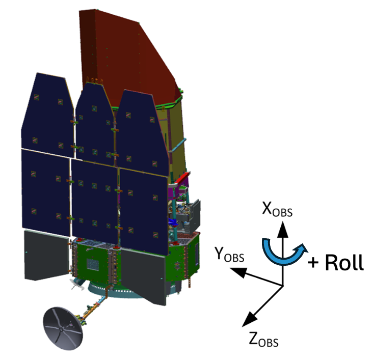
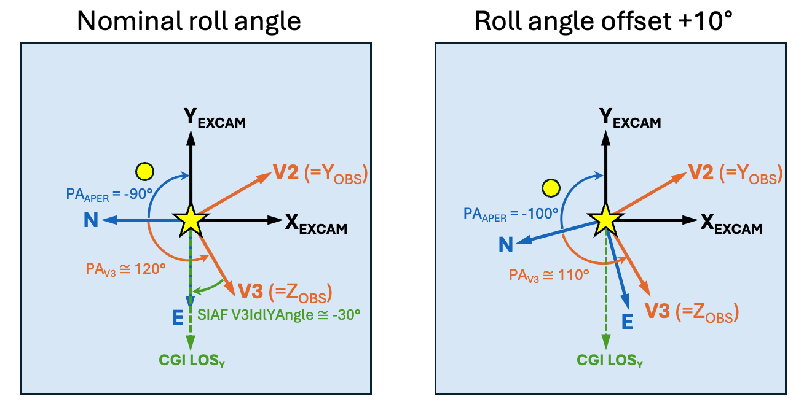
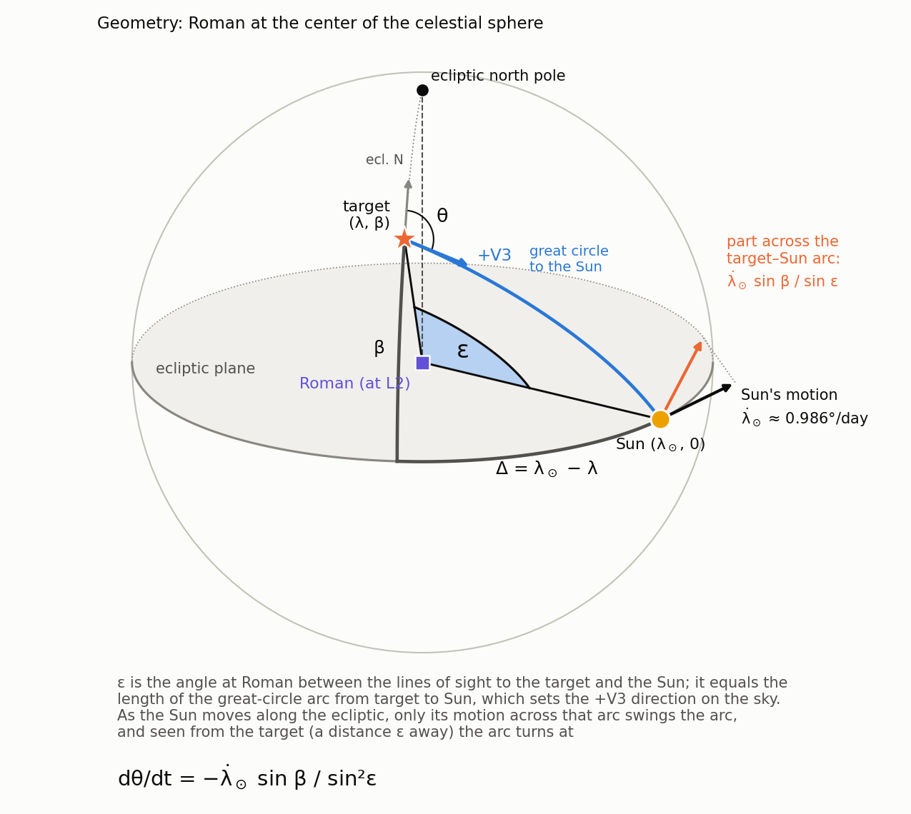
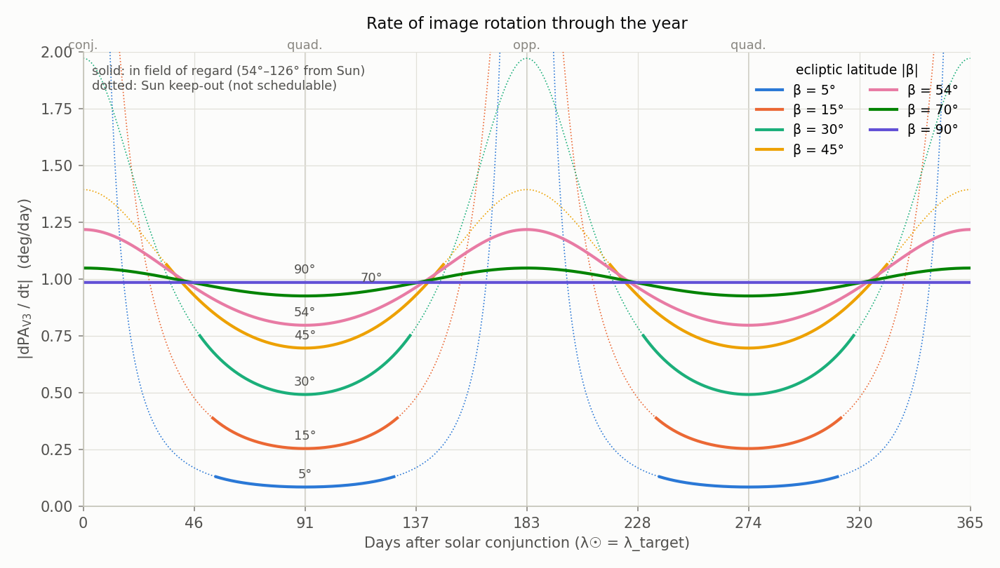
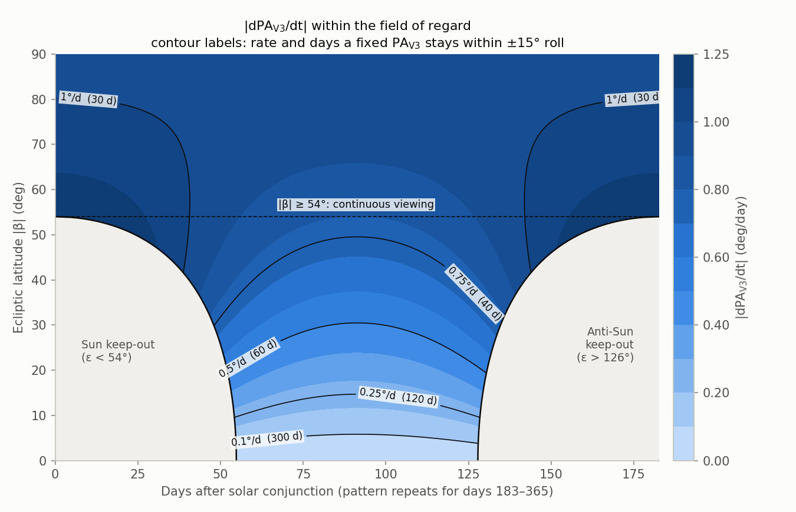
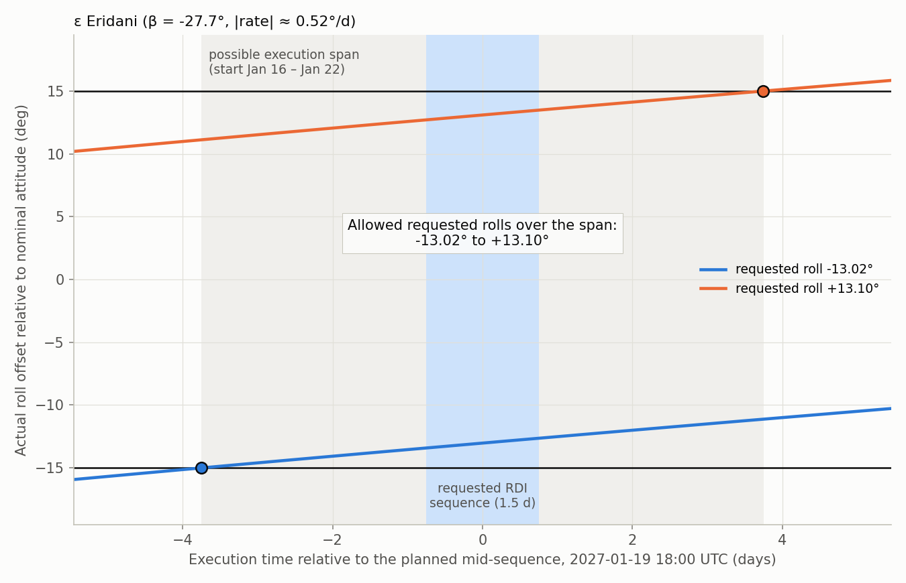
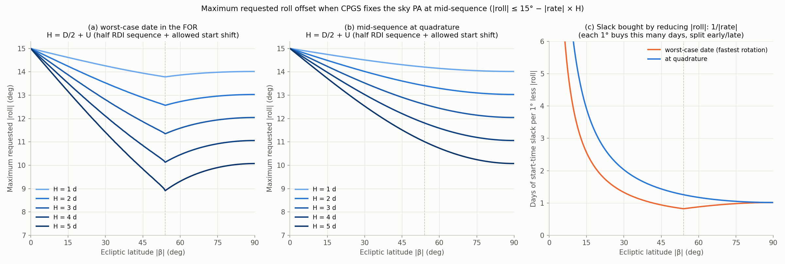
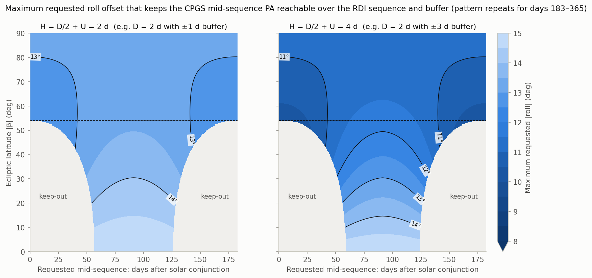
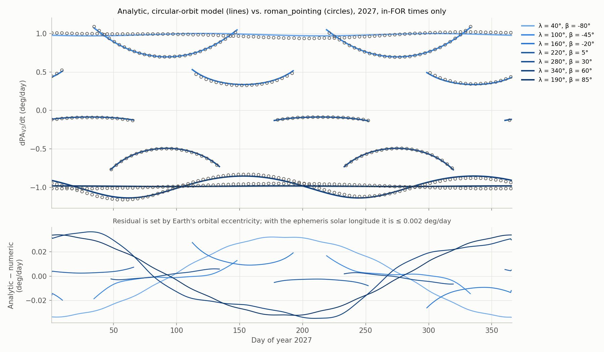

# Rate of Roman field rotation (PA_V3) vs. time of year and ecliptic latitude

<table>
<tr>
<td width="35%" valign="top"></td>
<td width="65%" valign="top"></td>
</tr>
<tr>
<td valign="top">

**Observatory coordinate system.** In the right-handed spacecraft coordinate system:

* The nominal attitude for a given pointing direction is set to minimize the angle between the sunshield normal vector (Z) and the observatory-Sun vector.
* A positive roll angle offset is a counterclockwise rotation of the spacecraft about X, looking down at the origin
  (facing the primary mirror).
* Facing the sky, the same roll angle change causes the sky-projected vectors Y and Z to rotate clockwise.

</td>
<td valign="top">

**EXCAM geometry.** Sky and observatory axes in the EXCAM data frame for an example pointing attitude, before and after a +10° roll offset.

* **Viewing direction.** In an EXCAM data frame, the line of sight to the sky goes into the page.
* **Observatory axes.** At all times and for all attitudes, the orientations of the observatory vectors Y_OBS and Z_OBS (V2 and V3 in
  Science Center terminology) remain fixed in the EXCAM frame. Over the course of a year, on a given target, the sky scene rotates. 
* **Field orientation.** PA_V3 is the position angle of V3 relative to celestial North. At the nominal attitude in this example, the EXCAM North Angle, PA_APER, is -90°. PA_V3 is offset from PA_APER by a constant angle of approximately 150°. 
* **SIAF orientation parameter.** The orientation of V3 on EXCAM is determined by the instrument boresight calibration. The SIAF parameter V3IdlYAngle encodes this as the angle between V3 and CGI line-of-sight Y axis that coincides with EXCAM -Y. The measured value of V3IdlYAngle is close to -30°.
* **Roll offset.** A positive roll offset causes the sky scene to rotate counterclockwise in the EXCAM data frame. This decreases the position angle of Z_OBS (V3): the +10° offset on the right lowers both
  PA_V3 and PA_APER by 10°.

</td>
</tr>
</table>

This note derives an analytic model for the rate of change of PA_V3 at the nominal attitude, validates it against
`roman_pointing`, and turns it into scheduling guidelines for roll offsets and fixed-PA observations. PA_V3 is the same
angle as PA_Z, returned by `getRomanPositionAngle` in `roman_pointing`.

**Files.**

* [`src/roman_pointing/field_rotation.py`](../../src/roman_pointing/field_rotation.py): the model, importable as
  `roman_pointing.field_rotation`.
  * Constants: the mean solar longitude rate (`SUN_RATE`), the J2000 obliquity from ERFA (`OBLIQUITY`), the FOR limits
    (`SUN_ANG_MIN`, `SUN_ANG_MAX`), and the roll limit (`ROLL_MAX`).
  * Analytic functions: the PA and its rate in ecliptic coordinates (`pa_from_ecliptic_north`, `pa_v3_rate`,
    `ecliptic_north_offset`), and the circular-orbit solar longitude by day of year (`sun_longitude_doy`).
  * FOR-window and fixed-PA calculations: `for_window`, `pa_swing_in_window`, `fixed_pa_window`.
  * `pa_v3_drift`: PA_V3 vs. time for a specific target, computed with `calcRomanAngles` and `getRomanPositionAngle`
    and the solar ephemeris.
* [`tools/field_rotation_rate.py`](../../tools/field_rotation_rate.py): validation, figures, and tables for sections 3,
  5, and 6.
  * `validate` compares the model with `roman_pointing` (section 6).
  * It writes the `pa_v3_rate_*.png` figures and prints the fixed-PA guideline tables of section 5.
  * It also defines the chart style shared with `plan_roll_limits.py`.
* [`tools/plan_roll_limits.py`](../../tools/plan_roll_limits.py): the roll-limit calculator for sections 4 and 5.
  * For one target and RDI sequence, it prints the allowed roll offsets and the reachable fixed sky PAs.
  * Targets are given by name (`--target`) or position (`--ra/--dec`).
  * Optional arguments check two requested PAs (`--pa`) or plot the RDI sequence (`--plot`).
  * `--figures` writes the worked-example and generic `roll_limits_*.png` figures and prints the roll guideline table.
* [`docs/Notebooks/roll_angle_limit_examples.ipynb`](../Notebooks/roll_angle_limit_examples.ipynb): the worked
  examples of sections 4 and 5, run with the calculator, with this page's EXCAM figure.

To regenerate the figures and tables in this directory, run from the repository root:

```
PYTHONPATH=src python tools/field_rotation_rate.py -o docs/field_rotation_rate
PYTHONPATH=src python tools/plan_roll_limits.py --figures -o docs/field_rotation_rate
```

## Summary

For a target at ecliptic latitude β, the nominal-roll position angle PA_V3 changes at

$$
\boxed{\frac{d\,\mathrm{PA_{V3}}}{dt} = -\,\dot\lambda_\odot\,\frac{\sin\beta}{\sin^2\varepsilon}
= -\,\dot\lambda_\odot\,\frac{\sin\beta}{1-\cos^2\beta\,\cos^2(\lambda_\odot-\lambda)}}
\qquad \dot\lambda_\odot \approx 0.9856^\circ/\mathrm{day}
$$

where ε is the Sun–target angle, λ is the target's ecliptic longitude, and λ☉ is the Sun's ecliptic longitude.
PA is measured east of north.

Practical consequences, assuming the 54°–126° Sun-angle field of regard (FOR) and ±15° off-nominal roll:

* **The field rotation rate depends only on β and ε.** 
* **The sign of the field rotation is determined by the N/S hemisphere of the target with respect to the ecliptic.** PA_V3 decreases with time for northern-ecliptic targets and increases for southern ones.
* **Within the FOR the rate is bounded:**
  * For |β| < 54°: 0.986 |sin β| ≤ |rate| ≤ 1.51 |sin β| deg/day.
    * The minimum is at quadrature (ε = 90°).
    * The maximum is at the FOR edges (ε = 54° or 126°).
  * For |β| ≥ 54° (continuous viewing): 0.986 |sin β| ≤ |rate| ≤ 0.986 / |sin β| deg/day. PA_V3 turns a full 360° per year.
  * The largest rate anywhere in the FOR is **1.22°/day**. It occurs at |β| ≈ 54° at the FOR edge (about 1.26°/day near
    perihelion in early January).
* **How long a single fixed PA_V3 stays reachable with ±15° roll:**

  | Target latitude | Days |
  |---|---|
  | \|β\| ≲ 20° (whole FOR window) | ~73–78 |
  | \|β\| = 30° | 53–57 |
  | \|β\| = 45° | 33–42 |
  | \|β\| ≈ 54° (worst case) | 24.5 |
  | Ecliptic poles | 30 |
* **Maximum requested roll offsets** ([section 4](#4-maximum-roll-offsets-when-cpgs-fixes-the-pa-at-mid-sequence)).
  CPGS fixes the sky PAs of each RDI sequence (the scheduled block of observations on a given target) at the planned
  middle of the sequence (mid-sequence). To keep that PA reachable over an RDI sequence of duration D, with the
  start allowed to move by ±U days:

  $$ |A_\mathrm{req}|,\ |B_\mathrm{req}| \le 15^\circ - |\mathrm{rate}| \times (D/2 + U) $$

  Each degree of |roll| given up buys 1/|rate| days of start-time slack, about 0.8–1.6 days per degree for
  |β| ≳ 40°. `tools/plan_roll_limits.py` computes the limits for a specific target, start date, duration and start shift.
* **Fixed-PA observations** (e.g., slit spectroscopy; [section 5](#5-fixed-pa-observations-eg-slit-spectroscopy)).
  The observer specifies two exact sky PAs, observed alternately within one RDI sequence. Both must stay reachable with ±15° of
  roll over the RDI sequence's possible execution span T, so they can be at most 30° − ΔPA(T) ≈ 30° − |rate| × T apart.
  `tools/plan_roll_limits.py` gives the reachable interval, whose ends are the maximum-separation pair.

## 1. Geometry and conventions

In `calcRomanAngles`, the nominal attitude starts with the body +Z axis (b₃) on the Sun. Yaw and pitch then put +X (b₁)
on the target. After the pitch rotation, +Z is the Sun direction projected onto the sky plane at the target.
`getRomanPositionAngle` measures +Z from celestial north about the boresight. Comparing it with astropy's
`position_angle` confirms the sense is the standard **east of north**.

So **PA_V3 is the position angle of the Sun as seen from the target**. EXCAM differs only by a constant:
PA_APER ≈ PA_V3 + 150°. `getEXCAMPositionAngle` uses a nominal 150° offset, which will be replaced by a calibrated
value from the SIAF reference file. Roll about +X (`applyRollAngle`) shifts PA_V3 one-for-one;
+10° of roll gives −10.000° in PA_V3. Neither offset changes the rate, so everything below applies equally to PA_V3,
PA_APER, and any rolled attitude.

## 2. Derivation

Work in ecliptic coordinates and consider the spherical triangle K–T–☉:

* K is the ecliptic north pole.
* T is the target at (λ, β).
* ☉ is the Sun at (λ☉, 0).

Its sides and angles are:

| Element | Value |
|---|---|
| Side K–T | 90° − β |
| Side K–☉ | 90° |
| Side T–☉ | ε (Sun–target angle) |
| Angle at K | Δ ≡ λ☉ − λ |
| Angle at T | θ, the PA of the Sun measured from ecliptic north (toward ecliptic east) |

The standard position-angle formula with β☉ = 0 gives

$$ \tan\theta = \frac{\sin\Delta}{-\sin\beta\cos\Delta}, \qquad
\theta = \operatorname{atan2}(\sin\Delta,\ -\sin\beta\cos\Delta) $$

and the spherical law of cosines gives cos ε = cos β cos Δ.

Differentiate θ with respect to Δ, writing y = sin Δ and x = −sin β cos Δ:

$$ \frac{d\theta}{d\Delta} = \frac{x\,y' - y\,x'}{x^2+y^2}
= \frac{-\sin\beta\,(\cos^2\Delta+\sin^2\Delta)}{\sin^2\Delta + \sin^2\beta\cos^2\Delta}
= \frac{-\sin\beta}{1-\cos^2\beta\cos^2\Delta} = -\frac{\sin\beta}{\sin^2\varepsilon}. $$

For a fixed target, dΔ/dt = λ̇☉. The PA of ecliptic north measured from celestial north, η(λ, β), is constant in time,
so PA_V3 = θ + η:

$$ \frac{d\,\mathrm{PA_{V3}}}{dt} = -\dot\lambda_\odot\,\frac{\sin\beta}{\sin^2\varepsilon}. $$

If the absolute PA is needed: with obliquity ι = 23.44°,
η = −atan2(sin ι cos λ, cos β cos ι − sin β sin ι sin λ). This reproduces `getRomanPositionAngle` to < 0.005°.

### Day-of-year form (circular orbit)

With a circular Earth orbit:

$$ \lambda_\odot(d) \approx \lambda_0 + 0.98561^\circ\,(d-1), \qquad d = \text{day of year} $$

Here λ₀ is the Sun's mean ecliptic longitude at Jan 1 0h UTC of the year, referred to the J2000 ecliptic and equinox
used by `roman_pointing`: 280.30° in 2026, 280.05° in 2027, and 279.80° in 2028. `sun_longitude_doy` computes it from
the IERS 2003 mean longitude of the Earth (`erfa.fae03`) plus 180°. The rate formula below uses the nominal
0.98565°/day; the 0.004% difference is negligible.

$$ \frac{d\,\mathrm{PA_{V3}}}{dt}(d;\lambda,\beta) = -0.98565^\circ\,\mathrm{day^{-1}}\;
\frac{\sin\beta}{1-\cos^2\beta\,\cos^2\!\big(\lambda_\odot(d)-\lambda\big)} $$

* **Timing by λ.** Target longitude only sets when the pattern occurs. Solar conjunction (Δ = 0) falls on day
  d ≈ 1 + (λ − λ₀)/0.98561 (mod 365.25). The pattern repeats every half year, because the rate is symmetric in
  Δ → 180° − Δ and Δ → Δ + 180°.
* **Eccentricity.** It changes λ̇☉ by ±3.4%: 1.019°/day in early January, 0.953°/day in early July. It also shifts
  λ☉ from its mean value by up to ±1.9° (~2 days), the equation of center.

Eccentricity is the only significant error of the circular model; it does not affect the rate formula in terms of ε.

## 3. Figures

**[pa_v3_rate_geometry_diagram.png](pa_v3_rate_geometry_diagram.png)**: Roman at the center of the celestial sphere,
using the example β = 45°, Δ = 60°, ε = 69°.

* Lines of sight run from Roman to the target and to the Sun. ε is the shaded angle between them at Roman.
* β is measured along the target's meridian, and Δ along the ecliptic.
* The great circle from the target to the Sun sets +V3 on the sky, and θ is +V3 measured from ecliptic north.
* At the Sun, its motion along the ecliptic is shown together with the part that crosses the target–Sun arc.



**[pa_v3_rate_vs_time.png](pa_v3_rate_vs_time.png)**: |rate| through the year vs. days after solar conjunction for
several β, with solid lines in the FOR.



**[pa_v3_rate_map.png](pa_v3_rate_map.png)**: |rate| vs. days after conjunction and |β| within the FOR. Each contour is
labeled with its rate and the number of days a fixed PA_V3 stays within ±15° at that rate (30°/rate).



## 4. Maximum roll offsets when CPGS fixes the PA at mid-sequence

### The problem

The observer requests a start date and two roll offsets, A_req and B_req. One RDI sequence, the scheduled block of
observations on a given target, contains several repetitions of both rolls, in alternating sequence. Roll offsets follow the `roman_pointing` convention: a roll of +A_req passed to
`applyRollAngle` changes PA_V3 (and PA_APER) by −A_req. CPGS converts each requested roll into an absolute sky PA
computed for the planned middle of the RDI sequence:

$$ P_A = P_{\mathrm{nom}}(t_\mathrm{mid}) - A_\mathrm{req}, \qquad P_B = P_{\mathrm{nom}}(t_\mathrm{mid}) - B_\mathrm{req} $$

The roll offsets must stay within ±15° of the nominal roll over the full time interval in which the RDI sequence might execute:

* **The RDI sequence itself** reaches D/2 on either side of mid-sequence, where D is the RDI sequence duration.
* **Any start shift** the schedulers may need adds U days on top of that, for example within a 3 day scheduling buffer.

Long RDI sequences, rolls requested near ±15°, and fast-rotating targets push A(t) past the limit. The RDI sequence then has only a
narrow range of legal start times.

### Guideline formula

Let H = D/2 + U be the farthest the RDI sequence can execute from the planned mid-sequence. To first order:

$$ \boxed{|A_\mathrm{req}|,\ |B_\mathrm{req}| \;\le\; 15^\circ - |\mathrm{rate}| \times \left(\tfrac{D}{2} + U\right)} $$

Inverting it, for given rolls the start time can move by up to

$$ U_\mathrm{max} = \frac{15^\circ - \max(|A_\mathrm{req}|, |B_\mathrm{req}|)}{|\mathrm{rate}|} - \frac{D}{2}. $$

Here |rate| = λ̇☉ |sin β| / sin²ε from section 2, evaluated at the requested date. Use the largest value over the
span for a conservative limit, and add ~3% in December–January. `tools/plan_roll_limits.py` evaluates the exact version.

* **Each degree of |roll| given up buys 1/|rate| days of start-time slack**, shared between early and late. That is
  about 1 day per degree at the ecliptic poles, 0.8 days per degree in the worst case near |β| ≈ 54°, and several
  days per degree near the ecliptic.
* **The two rolls limit different sides.** For a northern-ecliptic target (β > 0), PA_V3 decreases with time, and so
  does the needed roll A(t). Running late pushes a negative roll further negative, and running early pushes a positive
  roll further positive. So for β > 0:
  * the negative roll limits how late the RDI sequence can run, and
  * the positive roll limits how early it can run.

  The roles swap for β < 0. If the buffer is one-sided, only one roll needs the reduced limit; the other can go to
  15° − |rate| × D/2.

### Worked example

**Constraints.**

* Target: ε Eridani, resolved by name with `--target "eps Eri"` (found in CORGIDB): RA 53.228°, Dec −9.458°
  (β = −27.7°).
* RDI sequence duration D = 1.5 days (conservative), planned to start 2027-01-19 00:00 UTC, so CPGS sets the sky PA for the
  planned mid-sequence at 2027-01-19 18:00 UTC.
* The start may move up to 3 days early or late (U = 3 days, H = D/2 + U = 3.75 days). The RDI sequence can therefore start
  anywhere in the Jan 16–22 scheduling window (Jan 16 00:00 to Jan 22 00:00 UTC) and may end as late as Jan 23 12:00.
* Over that span the Sun angle is 103.5°–110.2° and PA_V3 increases at ≈ 0.52°/day.

**Allowed roll offsets.** The calculator evaluates the constraints with `roman_pointing` and the solar ephemeris:

```
PYTHONPATH=src python tools/plan_roll_limits.py --target "eps Eri" \
    --start 2027-01-19T00:00:00 --duration 1.5 --early 3 --late 3
```

```
  Found 'eps Eri' in CORGIDB (StarAliases lookup).
Target eps Eri: RA 53.2284 deg, Dec -9.4582 deg (ICRS, J2000)
Target beta = -27.71 deg, Sun angle 103.5-110.2 deg, dPA_V3/dt at mid-sequence = +0.517 deg/day
Allowed requested roll offsets (applyRollAngle sense): -13.02 to +13.10 deg; symmetric limit +/-13.02 deg
Reachable fixed sky PA_V3 over the span: 232.15 to 258.27 deg; maximum-separation pair 232.15 and 258.27 deg (separation 26.12 deg)
```

The last line is the fixed-PA result of [section 5](#5-fixed-pa-observations-eg-slit-spectroscopy).

**Reading the plot** ([roll_limits_example.png](roll_limits_example.png)):

* The plot shows the actual roll angle relative to the allowed ±15° envelope around the nominal attitude, evaluated at
  each time in the execution time window, for the two limiting requested rolls.
* The lines slope upward because PA_V3 increases for β < 0.
* The −13.02° roll specified to CPGS translates to −15° at the start of the span (earliest start), and the +13.10° roll
  reaches +15° at its end (latest end). So the negative roll is limited by running early, and the positive roll by
  running late.
* **One-sided shift.** If the start can only slip later (`--early 0 --late 3`), the negative roll is limited only by
  the RDI sequence length, and the allowed range widens to −14.61° to +13.10°.



### Guideline table

Maximum requested |roll| (°) for half-spans H = D/2 + U, at the worst-case date in the FOR and with mid-sequence at
quadrature. The last column gives the days of start-time slack gained per degree of |roll| given up.

| \|β\| | max \|rate\|, worst / quad. (°/d) | H = 1 d | H = 2 d | H = 3 d | H = 4 d | slack per 1° (d), worst / quad. |
|---:|---:|---:|---:|---:|---:|---:|
| 5  | 0.13 / 0.09 | 14.9 / 14.9 | 14.7 / 14.8 | 14.6 / 14.7 | 14.5 / 14.7 | 7.6 / 11.6 |
| 10 | 0.26 / 0.17 | 14.7 / 14.8 | 14.5 / 14.7 | 14.2 / 14.5 | 14.0 / 14.3 | 3.8 / 5.8 |
| 20 | 0.52 / 0.34 | 14.5 / 14.7 | 14.0 / 14.3 | 13.5 / 14.0 | 13.0 / 13.6 | 1.9 / 3.0 |
| 30 | 0.75 / 0.49 | 14.3 / 14.5 | 13.5 / 14.0 | 12.8 / 13.5 | 12.1 / 13.0 | 1.3 / 2.0 |
| 40 | 0.97 / 0.63 | 14.0 / 14.4 | 13.1 / 13.7 | 12.2 / 13.1 | 11.2 / 12.5 | 1.0 / 1.6 |
| 45 | 1.07 / 0.70 | 13.9 / 14.3 | 12.9 / 13.6 | 11.9 / 12.9 | 10.8 / 12.2 | 0.9 / 1.4 |
| 50 | 1.15 / 0.76 | 13.9 / 14.2 | 12.7 / 13.5 | 11.6 / 12.7 | 10.5 / 12.0 | 0.9 / 1.3 |
| 54 | 1.22 / 0.80 | 13.8 / 14.2 | 12.6 / 13.4 | 11.3 / 12.6 | 10.1 / 11.8 | 0.8 / 1.3 |
| 60 | 1.14 / 0.85 | 13.9 / 14.1 | 12.7 / 13.3 | 11.6 / 12.4 | 10.4 / 11.6 | 0.9 / 1.2 |
| 70 | 1.05 / 0.93 | 14.0 / 14.1 | 12.9 / 13.1 | 11.9 / 12.2 | 10.8 / 11.3 | 1.0 / 1.1 |
| 90 | 0.99 / 0.99 | 14.0 / 14.0 | 13.0 / 13.0 | 12.0 / 12.0 | 11.1 / 11.1 | 1.0 / 1.0 |

**Rule of thumb for CPP guidance.** To keep the full 2–3 day buffer for a 1–2 day RDI sequence (H ≈ 3–4 days):

| Target latitude | Maximum \|roll\| |
|---|---|
| \|β\| ≲ 20° | 13–14.7° |
| \|β\| ≈ 30–50°, near quadrature | 12–13.5° |
| \|β\| ≈ 30–50°, in the worst season | 10.5–12.8° |
| \|β\| ≈ 50–60°, in the worst season | as low as 10° |
| Continuous viewing zone | 11–12°, nearly independent of date |

**[roll_limits_vs_latitude.png](roll_limits_vs_latitude.png)**:

* (a, b) Maximum |roll| vs. |β| for H = 1–5 days, at the worst-case date and at quadrature.
* (c) Slack per degree, 1/|rate|.



**[roll_limits_map.png](roll_limits_map.png)**: maximum |roll| vs. requested mid-sequence date (days after solar
conjunction) and |β|, for H = 2 and 4 days.



### Calculator for a specific target

`tools/plan_roll_limits.py` computes the allowed offsets for one target and RDI sequence directly with `roman_pointing`,
using the actual solar ephemeris:

```
PYTHONPATH=src python tools/plan_roll_limits.py --ra 108.949 --dec 67.783 \
    --start 2027-03-01T00:00:00 --duration 2 --early 3 --late 3
```

```
Target beta = 45.00 deg, Sun angle 107.5-112.8 deg, dPA_V3/dt at mid-sequence = -0.806 deg/day
Allowed requested roll offsets (applyRollAngle sense): -11.83 to +11.72 deg; symmetric limit +/-11.72 deg
```

With `--early 0 --late 3` (start can only slip later), the positive roll is limited only by the RDI sequence length: −11.83° to
+14.19°. The calculator warns if any part of the span falls outside the field of regard. It agrees with the analytic
limits to within 0.03°. Add `--plot` (and optionally `--name`) to write a figure like the worked example for the
same inputs; `-o` sets the output directory (default: current directory).

Instead of `--ra/--dec`, `--target NAME` resolves the target by name with `get_target_coords` from
`roman_pointing.roman_observability`: the Roman Coronagraph database (CORGIDB) first, then SIMBAD. The J2000 position is
used and proper motion is neglected, as elsewhere in this calculator. The name also labels the `--plot` figure. For
high-proper-motion stars the CORGIDB and SIMBAD positions can differ by arcseconds (e.g., 15″ for ε Eri), which changes
the limits by ≲ 0.01°.

## 5. Fixed-PA observations (e.g., slit spectroscopy)

Here the observer plans two exact PA_V3 position angles, $P_1$ and $P_2$, instead of roll offsets. One RDI sequence
contains several repetitions of both PAs, in alternating sequence. At each execution time the roll is adjusted so that PA_V3 lands on the requested value.

### Reachable PAs and the maximum-separation pair

A roll $A$ gives $\mathrm{PA_{V3}} = P_{\mathrm{nom}}(t) - A$, so position angle $P_1$ requires roll $A(t) = P_{\mathrm{nom}}(t) - P_1$. Over the possible
execution span of the RDI sequence (earliest start to latest end, of length T = D + early shift + late shift), $P_1$ is reachable
throughout only if

$$ \max_t P_{\mathrm{nom}}(t) - 15^\circ \le P_1 \le \min_t P_{\mathrm{nom}}(t) + 15^\circ . $$

Both $P_1$ and $P_2$ must lie in this interval. Its two ends are the pair of PAs with the largest separation:

$$ \big|P_2 - P_1\big|_\mathrm{max} = 2\times 15^\circ - \Delta\mathrm{PA}(T), $$

where ΔPA(T) ≈ |rate| × T is the nominal PA swing over the span. If ΔPA(T) > 30°, no single fixed PA is reachable for
the whole span. This is the result of section 4 in absolute terms: the interval ends are $P_{\mathrm{nom}}(t_\mathrm{mid}) - A_{\mathrm{max}}$ and $P_{\mathrm{nom}}(t_\mathrm{mid}) - A_{\mathrm{min}}$, where $A_{\mathrm{max}}$ and $A_{\mathrm{min}}$ are the allowed roll offsets.

### Calculator for a specific target

`tools/plan_roll_limits.py` prints the reachable interval with the roll limits. With `--pa PA1 PA2` it also checks two
requested PAs and gives the roll each one needs over the span.

**Example: HIP 71618 (33 Boo).**

* Target: resolved by name with `--target` (from SIMBAD; it is not in CORGIDB), RA 219.709°, Dec +44.405°
  (β = +55.4°, in the continuous viewing zone).
* RDI sequence duration D = 5 days, in the Apr 19–27, 2027 schedule window (Apr 19 00:00 to Apr 27 00:00 UTC).
* Centering the RDI sequence in the window allows a start shift of (8 − 5)/2 = 1.5 days, rounded up to 2 days early and late.
  The planned start is 2027-04-20 12:00 UTC and the planned mid-sequence 2027-04-23 00:00 UTC. The possible execution
  span is 9 days, Apr 18 12:00 to Apr 27 12:00.
* Over that span the Sun angle is 121.7°–123.5°, near the anti-Sun edge of the FOR, so PA_V3 rotates quickly
  (≈ 1.13°/day).

```
PYTHONPATH=src python tools/plan_roll_limits.py --target "HIP 71618" \
    --start 2027-04-20T12:00:00 --duration 5 --early 2 --late 2 --pa 5 20
```

```
  'HIP 71618' not found in CORGIDB — querying SIMBAD...
Target HIP 71618: RA 219.7093 deg, Dec +44.4045 deg (ICRS, J2000)
Target beta = 55.44 deg, Sun angle 121.7-123.5 deg, dPA_V3/dt at mid-sequence = -1.133 deg/day
Allowed requested roll offsets (applyRollAngle sense): -9.96 to +9.85 deg; symmetric limit +/-9.85 deg
Reachable fixed sky PA_V3 over the span: 1.36 to 21.17 deg; maximum-separation pair 1.36 and 21.17 deg (separation 19.81 deg)
PA1 = 5.00 deg: needed roll +1.17 to +11.36 deg over the span (reachable)
PA2 = 20.00 deg: needed roll -13.83 to -3.64 deg over the span (reachable)
```

Over the 9-day span PA_V3 swings by 10.2°, so the two PAs can be at most 19.8° apart: 1.36° and 21.17°. Any pair inside
that interval, such as 5° and 20°, is reachable throughout. Applying the needed rolls with `applyRollAngle` holds both
limiting PAs with |roll| ≤ 15° over the whole span.

### Guideline tables

All values below use the circular-orbit rate. To be conservative for spans in December–January, add ~3% to the swing.

| \|β\| | rate at quadrature (°/d) | max rate in FOR (°/d) | FOR window (d) | ΔPA across window (°) | longest span for a fixed PA, worst / at quadrature (d) |
|---:|---:|---:|---:|---:|---:|
| 5  | 0.09 | 0.13 | 73  | 7   | 73 / 73 |
| 10 | 0.17 | 0.26 | 74  | 15  | 74 / 74 |
| 20 | 0.34 | 0.52 | 79  | 31  | 77 / 77 |
| 30 | 0.49 | 0.75 | 87  | 50  | 53 / 57 |
| 40 | 0.63 | 0.97 | 102 | 75  | 39 / 45 |
| 45 | 0.70 | 1.07 | 114 | 93  | 33 / 42 |
| 50 | 0.76 | 1.15 | 134 | 120 | 29 / 39 |
| 54 | 0.80 | 1.22 | 183 | 180 | 24 / 37 |
| 60 | 0.85 | 1.14 | all year | 360/yr | 26 / 34 |
| 70 | 0.93 | 1.05 | all year | 360/yr | 28 / 32 |
| 90 | 0.99 | 0.99 | all year | 360/yr | 30 / 30 |

Maximum separation between the two PAs, 30° − ΔPA(T) (°), for a possible execution span of T days, with ±15° roll and
no extra margin, at the worst-case date in the FOR and centered on quadrature. "None" means no single fixed PA is
reachable for the whole span.

| \|β\| | T = 7 d, worst / quad. | T = 14 d, worst / quad. | T = 30 d, worst / quad. |
|---:|---:|---:|---:|
| 5  | 29.2 / 29.4 | 28.4 / 28.8 | 26.9 / 27.4 |
| 10 | 28.3 / 28.8 | 26.8 / 27.6 | 23.9 / 24.8 |
| 20 | 26.6 / 27.6 | 23.7 / 25.3 | 17.8 / 19.7 |
| 30 | 25.1 / 26.5 | 20.7 / 23.1 | 11.9 / 15.0 |
| 40 | 23.6 / 25.6 | 17.7 / 21.1 | 6.0 / 10.7 |
| 45 | 22.9 / 25.1 | 16.3 / 20.2 | 3.0 / 8.9 |
| 50 | 22.2 / 24.7 | 14.8 / 19.4 | none / 7.1 |
| 54 | 21.5 / 24.4 | 13.0 / 18.8 | none / 5.9 |
| 60 | 22.0 / 24.0 | 14.1 / 18.0 | none / 4.3 |
| 70 | 22.7 / 23.5 | 15.3 / 17.0 | none / 2.1 |
| 90 | 23.1 / 23.1 | 16.2 / 16.2 | 0.4 / 0.4 |

How to read these:

* **Low-latitude targets (|β| ≲ 20°)** keep most of the 30° between the two PAs for spans of several weeks, and a single
  fixed PA stays reachable for an entire visibility window.
* **Targets near |β| ≈ 54°** are the most demanding. Their worst-case span sits where the Sun angle passes near 54° or
  126°.
* **Within the continuous viewing zone**, the worst case shifts to the dates of closest Sun approach (Δ ≈ 0° or 180°).
  At the poles, the image rotates at a uniform ≈ 1°/day, so the separation is ≈ 30° − T × 1°/day.
* **Roll margin.** To hold back part of the roll range (e.g., for attitude-dependent constraints or execution margin),
  replace 2 × 15° by 2 × (15° − margin).

## 6. Validation against `roman_pointing`

`validate()` in `tools/field_rotation_rate.py` compares the model with `calcRomanAngles` + `getRomanPositionAngle` for 2027. It uses seven
synthetic targets with β from −80° to +85° at various longitudes, sampled every 0.5 day, and keeps only in-FOR times.

| Check | Result |
|---|---|
| Absolute PA_V3 (θ + η, ephemeris solar longitude) | ≤ 0.0043° |
| Rate, ephemeris solar longitude (tests the geometry) | ≤ 0.002 °/day |
| Rate, circular-orbit model vs. day of year | ≤ 0.036 °/day (≤ 3.4%, from eccentricity) |
| Solar longitude, circular-orbit model vs. ephemeris | −1.91° to +1.92° (equation of center) |
| PA sense vs. astropy `position_angle` of the Sun | 0.0000° difference (east of north confirmed) |



## 7. Assumptions and limitations

* **Roll-limit model (section 4).**
  * CPGS computes each RDI sequence's sky PAs once, for the planned mid-sequence. The PAs are held for the whole RDI sequence and are
    not recomputed if the RDI sequence moves within its buffer.
  * Rolls A and B alternate within one RDI sequence, so both sky PAs use the same planned mid-sequence and must stay reachable
    over the same span.
  * The guideline tables assume a symmetric buffer ±U; the calculator accepts separate early and late shifts.
  * The RDI sequence span plus buffer must lie inside the FOR.
  * Any additional attitude margin CPGS or the observatory reserves inside ±15° is not included; subtract it from 15°.
* **Fixed-PA model (section 5).** Both PAs alternate within one RDI sequence and are held exactly over its whole possible
  execution span, which must lie inside the FOR. The same roll-margin caveat applies.

* **Observatory position.** It is taken at the Sun–Earth L2 point, as in `getL2Positions`. Roman's real halo orbit
  probably displaces the Sun direction by a few tenths of a degree with a ~6-month period. That would change the rate by
  ≲ 0.01°/day, which matters only in relative terms for very-low-|β| targets, whose rates are ~0.1°/day. This is an
  order-of-magnitude estimate; it has not been checked against the JPL Horizons Roman orbit (`-211`), which
  `calcRomanAngles` accepts as `r_obs_G` (see `Notebooks/roman_pointing_demo.ipynb`).
* **EXCAM aperture offset.** `calcRomanAngles` points the boresight (V1) at the target, and all PAs here are measured
  there. In practice the CGI aperture is placed on the target. The in-flight SIAF (`roman_siaf_inflight_20261013.xml`,
  aperture `CGI_CEN`) puts it at (V2, V3) = (−1103.7″, −841.3″), δ = 0.386° from V1. CPGS evaluates PAs with the
  current SIAF through the STScI backend, so its values include this offset. Upper bounds on the effect:
  * Absolute PA: north at the aperture is rotated from north at V1 by ≈ δ sin φ tan(Dec), where φ is the PA of
    the aperture offset from V1 and Dec is the target declination. The bound δ |tan(Dec)| is 0.07° at |Dec| = 10°,
    0.39° at 45°, 0.67° at 60°, and 2.2° at 80°. For the examples it is 0.06° (ε Eri) and 0.38° (HIP 71618). This
    shifts the PA_V3 and PA_APER values in sections 4 and 5, including the reachable fixed-PA interval, by the same
    amount at both ends.
  * Rate and PA drift: the fractional change is ≲ δ |tan(Dec)| (δ in radians), i.e., ≲ 0.7% at |Dec| = 45° and
    ≲ 1.2% at 60°. Over a ±30° drift this is ≲ 0.2° at 45°, so the roll-offset limits and the maximum fixed-PA
    separation are essentially unchanged.
  * Field of regard: the target's Sun angle differs from the boresight's by ≤ δ, which moves the FOR edges by
    ≤ 0.4 day.
* **Target and attitude limits.** Stellar parallax and proper motion are negligible. The FOR is taken as 54° ≤ ε ≤ 126°.
  The full ±15° roll is assumed available everywhere in the FOR.
* **Latitude frame.** β is the barycentric mean-ecliptic (J2000) latitude. In astropy, for a `SkyCoord` named `coord`,
  use `coord.transform_to(BarycentricMeanEcliptic).lat`.
