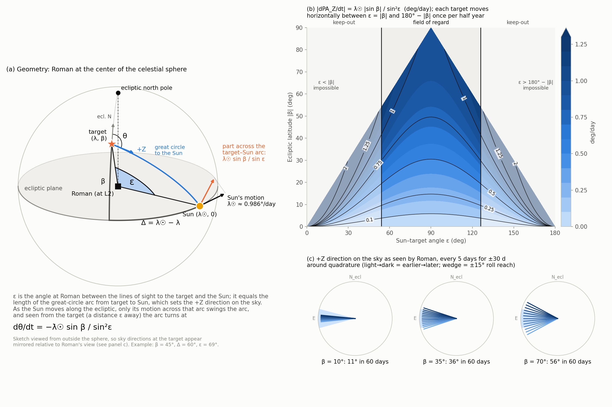
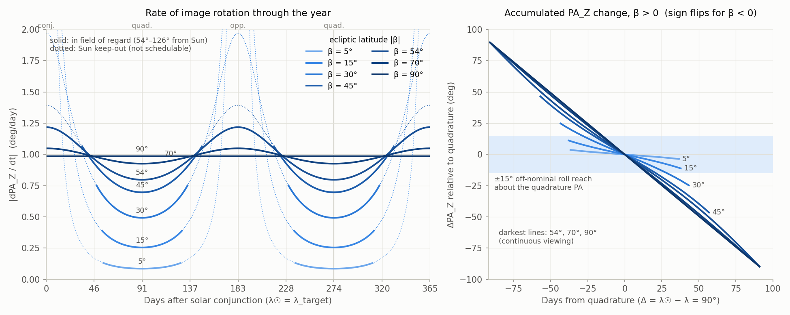
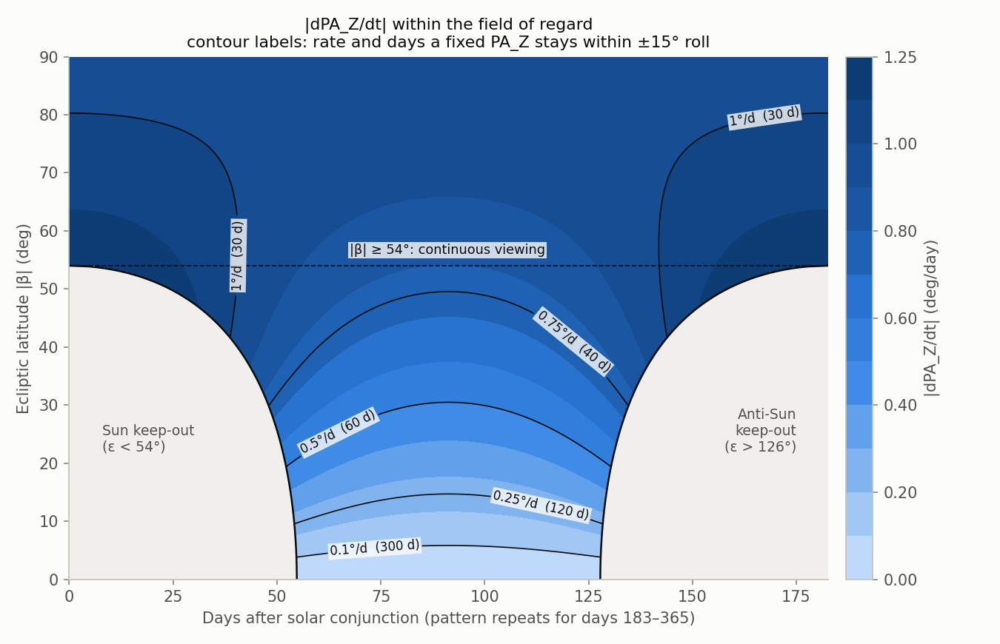
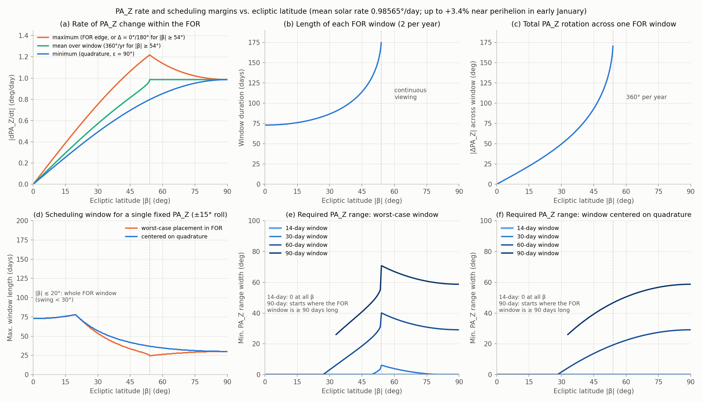
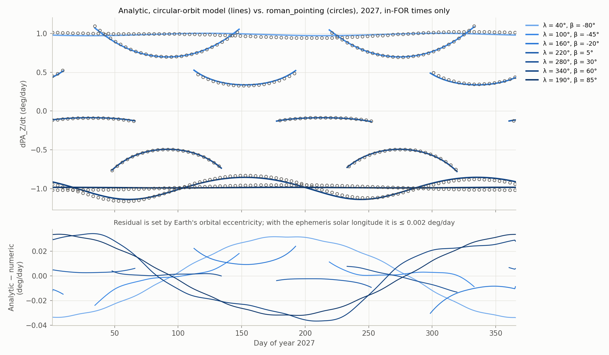

# Rate of change of the Roman image orientation (PA_Z) vs. time of year and ecliptic latitude

Analytic model, scheduling guidelines, and validation against `roman_pointing`.
Figures and numbers come from [`tools/pa_z_rate_analytic.py`](../../tools/pa_z_rate_analytic.py):

```
PYTHONPATH=src python tools/pa_z_rate_analytic.py -o docs/pa_z_rate_analytic
```

## Summary

For a target at ecliptic latitude β, the nominal-roll position angle PA_Z (and PA_EXCAM_Y = PA_Z + 150°)
changes at

$$
\boxed{\frac{d\,\mathrm{PA_Z}}{dt} = -\,\dot\lambda_\odot\,\frac{\sin\beta}{\sin^2\varepsilon}
= -\,\dot\lambda_\odot\,\frac{\sin\beta}{1-\cos^2\beta\,\cos^2(\lambda_\odot-\lambda)}}
\qquad \dot\lambda_\odot \approx 0.9856^\circ/\mathrm{day}
$$

where ε is the Sun–target angle, λ is the target's ecliptic longitude, and λ☉ is the Sun's ecliptic longitude.
PA is measured east of north.

Practical consequences, assuming the 54°–126° Sun-angle field of regard (FOR) and ±15° off-nominal roll:

* **The sign is fixed by the hemisphere.** PA_Z decreases with time for northern-ecliptic targets and increases for
  southern ones, all year. It never reverses.
* **The rate depends only on β and ε.** Right ascension, declination, and the equatorial-vs-ecliptic north offset
  set the absolute PA_Z but not its rate.
* **Within the FOR the rate is bounded:**
  * For |β| < 54°: 0.986 |sin β| ≤ |rate| ≤ 1.51 |sin β| deg/day.
    * The minimum is at quadrature (ε = 90°).
    * The maximum is at the FOR edges (ε = 54° or 126°).
  * For |β| ≥ 54° (continuous viewing): 0.986 |sin β| ≤ |rate| ≤ 0.986 / |sin β| deg/day. PA_Z turns a full 360° per year.
  * The largest rate anywhere in the FOR is **1.22°/day**. It occurs at |β| ≈ 54° at the FOR edge (about 1.26°/day near
    perihelion in early January).
* **How long a single fixed PA_Z stays reachable with ±15° roll:**

  | Target latitude | Days |
  |---|---|
  | \|β\| ≲ 20° (whole FOR window) | ~73–78 |
  | \|β\| = 30° | 53–57 |
  | \|β\| = 45° | 33–42 |
  | \|β\| ≈ 54° (worst case) | 24.5 |
  | Ecliptic poles | 30 |
* **Scheduling-margin rule.** Suppose a visit may fall anywhere in a window of T days, during which the nominal PA_Z
  sweeps ΔPA(T). The PA_Z constraint range in the program must then be at least

  $$ W_\mathrm{min} = \max\left(0,\ \Delta\mathrm{PA}(T) - 2\times 15^\circ\right) $$

  and must contain the band [PA_end + 15°, PA_start − 15°] (for β > 0). ΔPA(T) is given exactly by the closed form
  below, or roughly by |rate| × T.

## 1. Geometry and conventions

In `calcRomanAngles`, the nominal attitude starts with the body +Z axis (b₃) on the Sun. Yaw and pitch then put +X (b₁)
on the target. After the pitch rotation, +Z is the Sun direction projected onto the sky plane at the target.
`getRomanPositionAngle` measures +Z from celestial north about the boresight. Comparing it with astropy's
`position_angle` confirms the sense is the standard **east of north**.

So **PA_Z is the position angle of the Sun as seen from the target**. EXCAM differs only by a constant:
`getEXCAMPositionAngle` returns PA_EXCAM_Y = PA_Z + 150°. Roll about +X (`applyRollAngle`) shifts PA_Z one-for-one;
+10° of roll gives −10.000° in PA_Z. Neither offset changes the rate, so everything below applies equally to PA_Z,
PA_EXCAM_Y, and any rolled attitude.

## 2. Derivation

Work in ecliptic coordinates and consider the spherical triangle K–T–☉:

* K is the ecliptic north pole.
* T is the target at (λ, β).
* ☉ is the Sun at (λ☉, 0).

Its sides and angles are:

| Element | Value |
|---|---|
| Side K–T | 90° − β |
| Side K–☉ | 90° |
| Side T–☉ | ε (Sun–target angle) |
| Angle at K | Δ ≡ λ☉ − λ |
| Angle at T | θ, the PA of the Sun measured from ecliptic north (toward ecliptic east) |

The standard position-angle formula with β☉ = 0 gives

$$ \tan\theta = \frac{\sin\Delta}{-\sin\beta\cos\Delta}, \qquad
\theta = \operatorname{atan2}(\sin\Delta,\ -\sin\beta\cos\Delta) $$

and the spherical law of cosines gives cos ε = cos β cos Δ.

Differentiate θ with respect to Δ, writing y = sin Δ and x = −sin β cos Δ:

$$ \frac{d\theta}{d\Delta} = \frac{x\,y' - y\,x'}{x^2+y^2}
= \frac{-\sin\beta\,(\cos^2\Delta+\sin^2\Delta)}{\sin^2\Delta + \sin^2\beta\cos^2\Delta}
= \frac{-\sin\beta}{1-\cos^2\beta\cos^2\Delta} = -\frac{\sin\beta}{\sin^2\varepsilon}. $$

For a fixed target, dΔ/dt = λ̇☉. The PA of ecliptic north measured from celestial north, η(λ, β), is constant in time,
so PA_Z = θ + η:

$$ \frac{d\,\mathrm{PA_Z}}{dt} = -\dot\lambda_\odot\,\frac{\sin\beta}{\sin^2\varepsilon}. $$

If the absolute PA is needed: with obliquity ι = 23.44°,
η = −atan2(sin ι cos λ, cos β cos ι − sin β sin ι sin λ). This reproduces `getRomanPositionAngle` to < 0.005°.

**Geometric reading** ([diagram](pa_z_rate_geometry_diagram.png), panel a):

1. The Sun moves along the ecliptic at λ̇☉. Only the part of its motion across the T–☉ arc rotates that arc.
2. In the triangle, the angle ψ at ☉ satisfies cos ψ = sin β / sin ε. So the cross-arc speed is λ̇☉ sin β / sin ε.
3. Seen from T, a point at angular distance ε moving sideways at speed v turns the arc at v / sin ε.

The two factors of 1/sin ε have different origins. One is the obliquity of the Sun's motion relative to the arc. The
other is the lever arm. Their product gives the 1/sin²ε dependence.

* **Near the ecliptic** (β → 0), the Sun moves almost along the arc, which stays pointed along the ecliptic. The image
  barely rotates.
* **Near the ecliptic pole** (β → 90°), the arc is a meridian of the pole. It turns at exactly the solar rate.

### Day-of-year form (circular orbit)

With a circular Earth orbit:

$$ \lambda_\odot(d) \approx 280.46^\circ + 0.98565^\circ\,(d-1), \qquad d = \text{day of year} $$

$$ \frac{d\,\mathrm{PA_Z}}{dt}(d;\lambda,\beta) = -0.98565^\circ\,\mathrm{day^{-1}}\;
\frac{\sin\beta}{1-\cos^2\beta\,\cos^2\!\big(\lambda_\odot(d)-\lambda\big)} $$

* **Timing by λ.** Target longitude only sets when the pattern occurs. Solar conjunction (Δ = 0) falls on day
  d ≈ 1 + (λ − 280.46°)/0.98565 (mod 365.25). The pattern repeats every half year, because the rate is symmetric in
  Δ → 180° − Δ and Δ → Δ + 180°.
* **Eccentricity.** It changes λ̇☉ by ±3.4%: 1.019°/day in early January, 0.953°/day in early July. It also shifts
  λ☉ by up to ~2° (~2 days). These are the only significant errors of the circular model.

### Closed-form results for one FOR window (|β| < 54°)

The target enters the FOR at ε = 54° and exits at ε = 126° (or the reverse). In terms of Δ, the window runs from
Δ₁ = arccos(cos 54° / cos β) to 180° − Δ₁:

$$ \text{duration} = \frac{180^\circ - 2\Delta_1}{\dot\lambda_\odot}, \qquad
|\Delta\mathrm{PA_Z}|_\text{window} = 2\arctan\!\left(\frac{|\sin\beta|\cos 54^\circ}{\sqrt{\cos^2\beta-\cos^2 54^\circ}}\right). $$

For any interval, ΔPA_Z = θ(Δ(t₂)) − θ(Δ(t₁)) exactly, with θ = atan2(sin Δ, −sin β cos Δ).

## 3. Figures

**[pa_z_rate_geometry_diagram.png](pa_z_rate_geometry_diagram.png)**: the requested diagram.

* (a) 3D geometry with Roman at the center of the celestial sphere, using the example β = 45°, Δ = 60°, ε = 69°.
  * Lines of sight run from Roman to the target and to the Sun. ε is the shaded angle between them at Roman.
  * β is measured along the target's meridian, and Δ along the ecliptic.
  * The great circle from the target to the Sun sets +Z on the sky, and θ is +Z measured from ecliptic north.
  * At the Sun, its motion along the ecliptic is shown together with the part that crosses the target–Sun arc.
* (b) |rate| as a function of Sun angle ε and ecliptic latitude, with the FOR marked. Each target moves along a
  horizontal line between ε = |β| and 180° − |β| every half year.
* (c) The +Z direction every 5 days for 60 days around quadrature at β = 10°, 35°, and 70°, against the ±15° roll wedge.



**[pa_z_rate_vs_time.png](pa_z_rate_vs_time.png)**: |rate| through the year vs. days after solar conjunction for
several β, with solid lines in the FOR. The right panel shows accumulated PA_Z change relative to quadrature, against
the ±15° roll band.



**[pa_z_rate_map.png](pa_z_rate_map.png)**: |rate| vs. days after conjunction and |β| within the FOR. Each contour is
labeled with its rate and the number of days a fixed PA_Z stays within ±15° at that rate (30°/rate).



**[pa_z_rate_vs_latitude.png](pa_z_rate_vs_latitude.png)**: summary vs. |β|:

* (a) Minimum, mean, and maximum in-FOR rate.
* (b) FOR window length.
* (c) PA_Z rotation across a window.
* (d) Longest window over which a single PA_Z is reachable with ±15° roll.
* (e, f) Minimum PA_Z range width needed for 14-, 30-, 60-, and 90-day scheduling windows. Panel (e) uses the worst
  placement in the FOR; panel (f) centers the window on quadrature.



## 4. Scheduling guideline tables

All values use the circular-orbit rate. To be conservative for windows in December–January, add ~3%.

| \|β\| | rate at quadrature (°/d) | max rate in FOR (°/d) | FOR window (d) | ΔPA across window (°) | fixed-PA window, worst / at quadrature (d) |
|---:|---:|---:|---:|---:|---:|
| 5  | 0.09 | 0.13 | 73  | 7   | 73 / 73 |
| 10 | 0.17 | 0.26 | 74  | 15  | 74 / 74 |
| 20 | 0.34 | 0.52 | 79  | 31  | 77 / 77 |
| 30 | 0.49 | 0.75 | 87  | 50  | 53 / 57 |
| 40 | 0.63 | 0.97 | 102 | 75  | 39 / 45 |
| 45 | 0.70 | 1.07 | 114 | 93  | 33 / 42 |
| 50 | 0.76 | 1.15 | 134 | 120 | 29 / 39 |
| 54 | 0.80 | 1.22 | 183 | 180 | 24 / 37 |
| 60 | 0.85 | 1.14 | all year | 360/yr | 26 / 34 |
| 70 | 0.93 | 1.05 | all year | 360/yr | 28 / 32 |
| 90 | 0.99 | 0.99 | all year | 360/yr | 30 / 30 |

Minimum PA_Z constraint range width W_min (°) for a scheduling window of T days, with ±15° roll and no extra margin.
A dash means the window is longer than the FOR window at that latitude.

| \|β\| | T=30 worst | T=60 worst | T=90 worst | T=30 quad. | T=60 quad. | T=90 quad. |
|---:|---:|---:|---:|---:|---:|---:|
| ≤ 20 | 0 | 0 | – | 0 | 0 | – |
| 30 | 0 | 3  | – | 0 | 2  | – |
| 40 | 0 | 13 | 35 | 0 | 10 | 34 |
| 45 | 0 | 19 | 41 | 0 | 14 | 39 |
| 50 | 0 | 25 | 48 | 0 | 17 | 44 |
| 54 | 6 | 40 | 71 | 0 | 19 | 47 |
| 60 | 4 | 37 | 67 | 0 | 22 | 51 |
| 70 | 1 | 32 | 62 | 0 | 26 | 55 |
| 90 | 0 | 29 | 59 | 0 | 29 | 59 |

How to read these:

* **Low-latitude targets (|β| ≲ 20°)** keep essentially one orientation for an entire visibility window. Roll alone
  covers it.
* **Targets near |β| ≈ 54°** are the most demanding for orientation-constrained programs. Their worst-case window sits
  where the Sun angle passes near 54° or 126°.
* **Within the continuous viewing zone**, the worst case shifts to the dates of closest Sun approach (Δ ≈ 0° or 180°).
  At the poles, the image rotates at a uniform ≈ 1°/day.
* **Roll margin.** To hold back part of the roll range (e.g., for attitude-dependent constraints or execution margin),
  replace 2 × 15° by 2 × (15° − margin).

## 5. Validation against `roman_pointing`

`validate()` in the script compares the model with `calcRomanAngles` + `getRomanPositionAngle` for 2027. It uses seven
synthetic targets with β from −80° to +85° at various longitudes, sampled every 0.5 day, and keeps only in-FOR times.

| Check | Result |
|---|---|
| Absolute PA_Z (θ + η, ephemeris solar longitude) | ≤ 0.0043° |
| Rate, ephemeris solar longitude (tests the geometry) | ≤ 0.002 °/day |
| Rate, circular-orbit model vs. day of year | ≤ 0.037 °/day (≤ 3.4%, from eccentricity) |
| PA sense vs. astropy `position_angle` of the Sun | 0.0000° difference (east of north confirmed) |



## 6. Assumptions and limitations

* **Observatory position.** It is taken at the Sun–Earth L2 point, as in `getL2Positions`. Roman's real halo orbit
  probably displaces the Sun direction by a few tenths of a degree with a ~6-month period. That would change the rate by
  ≲ 0.01°/day, which matters only in relative terms for very-low-|β| targets, whose rates are ~0.1°/day. This is an
  order-of-magnitude estimate; it has not been checked against the Horizons Roman ephemeris used in `drive_cpgs.py`.
* **Target and attitude limits.** Stellar parallax and proper motion are negligible. The FOR is taken as 54° ≤ ε ≤ 126°.
  The full ±15° roll is assumed available everywhere in the FOR.
* **Latitude frame.** β is the barycentric mean-ecliptic (J2000) latitude. In astropy, for a `SkyCoord` named `coord`,
  use `coord.transform_to(BarycentricMeanEcliptic).lat`.
