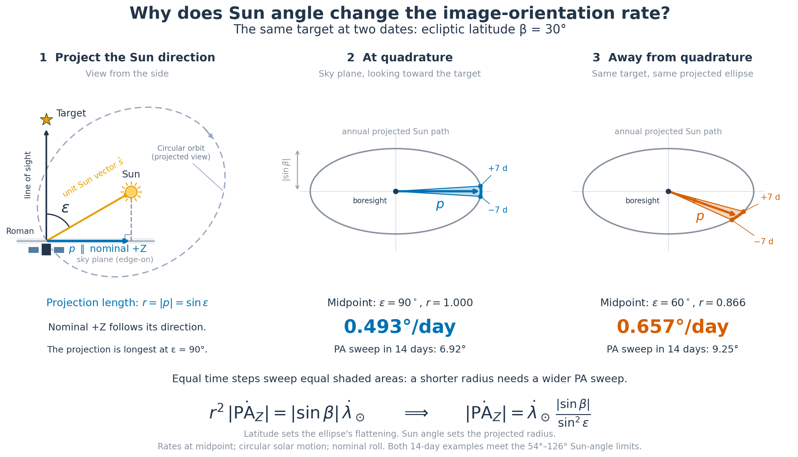
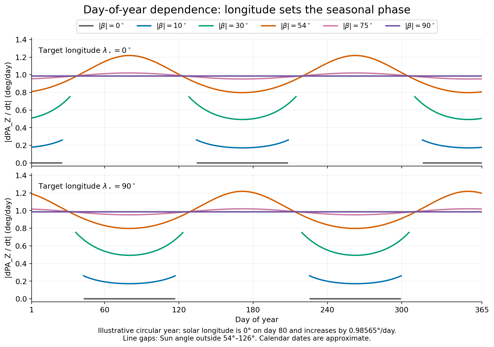
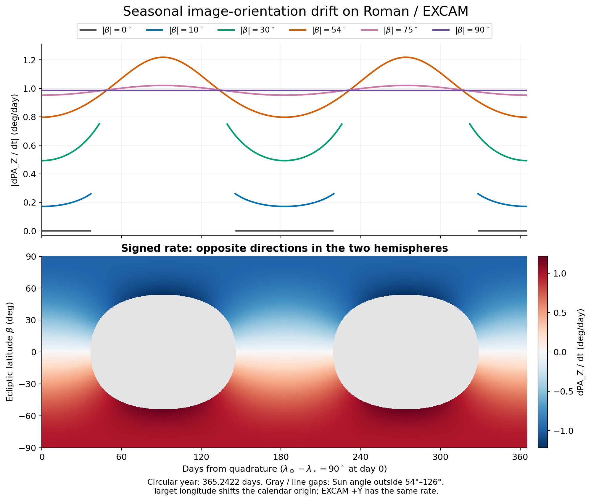
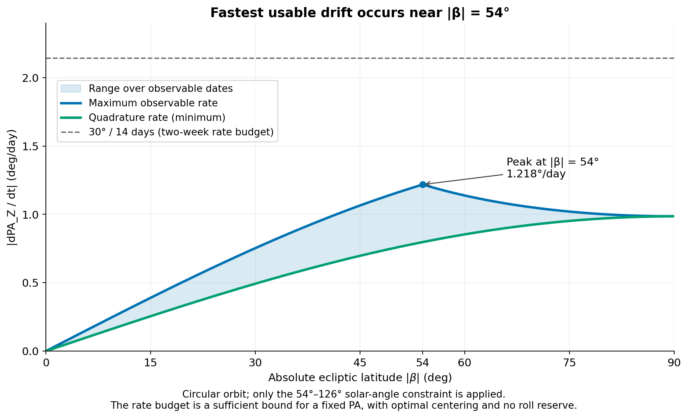
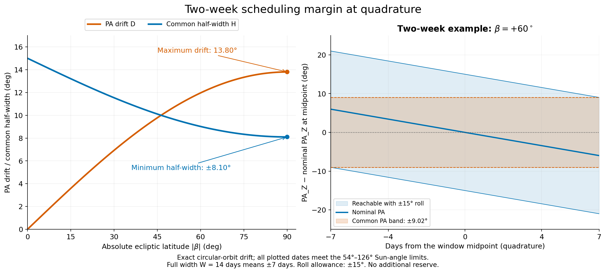

# Seasonal PA_Z drift and scheduling margin for Roman / EXCAM

For a fixed target at ecliptic longitude $\lambda_\star$ and latitude $\beta$, the nominal image-orientation rate is

$$
\boxed{
\frac{d\mathrm{PA}_{Z,0}}{dt}
=-\dot\lambda_\odot(t)\,
\frac{\sin\beta}
{1-\cos^2\beta\cos^2[\lambda_\odot(t)-\lambda_\star]}
=-\dot\lambda_\odot(t)\frac{\sin\beta}{\sin^2\epsilon(t)}
}
$$

Here $\lambda_\odot$ is the **Sun's longitude as seen from the observatory**, $\epsilon$ is the Sun–target separation, and the subscript 0 denotes zero off-nominal roll. With $\dot\lambda_\odot$ in degrees/day, the result is in degrees/day. Trigonometric arguments must use consistent angular units. The formula is exact for a stationary target and a Sun direction in a fixed ecliptic plane; constant orbital speed is an additional approximation.

**Latitude determines the shape and magnitude; target longitude determines when that shape occurs during the calendar year.** An absolute day-of-year curve cannot be specified from latitude alone. Northern targets have decreasing nominal PA_Z; southern targets have increasing PA_Z.

The [reproduction script](../tools/pa_z_scheduling.py) generates all five figures as PNG and PDF, the projection cartoon as SVG, a [numerical table](figures/pa_z/pa_z_scheduling_summary.csv), and a [validation record](figures/pa_z/validation.json).

The scheduling examples use a **14-day window centered on quadrature (±7 days)** with ±15° roll and no additional reserve. Every latitude retains a common PA half-width of at least **±8.10°** in this circular-orbit model.

## Geometry and sign convention

The repository's [`calcRomanAngles`](../src/roman_pointing/roman_pointing.py) aligns the boresight $\hat{\mathbf b}_1$ with the target and, at nominal roll, aligns $+Z$ with the projected Sun:

$$
\hat{\mathbf n}=(\cos\beta\cos\lambda_\star,\cos\beta\sin\lambda_\star,\sin\beta),
\qquad
\hat{\mathbf s}=(\cos\lambda_\odot,\sin\lambda_\odot,0),
$$

$$
\hat{\mathbf b}_3=
\frac{\hat{\mathbf s}-(\hat{\mathbf s}\cdot\hat{\mathbf n})\hat{\mathbf n}}
{\sqrt{1-(\hat{\mathbf s}\cdot\hat{\mathbf n})^2}}.
$$

At the target, ecliptic east and north are

$$
\hat{\mathbf e}=(-\sin\lambda_\star,\cos\lambda_\star,0),\qquad
\hat{\mathbf q}=(-\sin\beta\cos\lambda_\star,-\sin\beta\sin\lambda_\star,\cos\beta).
$$

Writing $\Delta=\lambda_\odot-\lambda_\star$, the unnormalized Sun projection has east and north components

$$
E=\hat{\mathbf s}\cdot\hat{\mathbf e}=\sin\Delta,
\qquad N=\hat{\mathbf s}\cdot\hat{\mathbf q}=-\sin\beta\cos\Delta.
$$

Thus, with $\gamma$ the fixed position angle of ecliptic north measured eastward from celestial north at this target,

$$
\mathrm{PA}_{Z,0}=\gamma+\operatorname{atan2}(\sin\Delta,-\sin\beta\cos\Delta)
\pmod{360^\circ}.
$$

The reference-frame rotation $\gamma$ changes the absolute PA but drops out of its derivative. Differentiating the two-argument arctangent gives

$$
\frac{d\mathrm{PA}_{Z,0}}{dt}
=\frac{N\dot E-E\dot N}{E^2+N^2}
=\frac{-\dot\lambda_\odot\sin\beta}
{\sin^2\Delta+\sin^2\beta\cos^2\Delta}.
$$

Since $\cos\epsilon=\cos\beta\cos\Delta$, this is the boxed expression above.

The actual code conventions are

$$
\mathrm{PA}_{Z}(t,\rho)=\mathrm{PA}_{Z,0}(t)-\rho,
\qquad
\mathrm{PA}_{\mathrm{EXCAM},+Y}=\mathrm{PA}_{Z}+150^\circ.
$$

Consequently, EXCAM +Y and PA_Z have identical seasonal rates at fixed roll $\rho$. If roll is actively adjusted, the total rate is $\dot{\mathrm{PA}}_{Z,0}-\dot\rho$. The orientation of a fixed sky feature *within detector coordinates* changes with the opposite sign to the detector's PA on the sky. The derivation concerns the latter, as returned by `getRomanPositionAngle` and `getEXCAMPositionAngle`.

## Why the Sun angle matters: a projection cartoon



Download the diagram as [PDF](figures/pa_z/pa_z_projection_cartoon.pdf) or [SVG](figures/pa_z/pa_z_projection_cartoon.svg).

The left panel shows Roman on an idealized circular orbit around the Sun, with an arrow indicating orbital motion. The orbit appears elliptical in this side projection; it is a circle in the ecliptic plane. The Sun direction is projected perpendicular to the target's line of sight. The **unnormalized projection** $\mathbf p=\hat{\mathbf s}-(\hat{\mathbf s}\cdot\hat{\mathbf n})\hat{\mathbf n}$ has length $r=\sin\epsilon$. Nominal +Z follows its direction. It is the projected vector that becomes shorter away from $\epsilon=90^\circ$; the spacecraft's unit +Z axis remains unit length.

In the two sky-plane views, the projected Sun traces the same ellipse, with semiaxes 1 and $|\sin\beta|$. Latitude fixes this flattening, but the Sun's place along the ellipse changes through the year. At quadrature the projected radius is longest. At a different Sun angle the radius is shorter.

The **equal shaded areas** explain why the rate contains $1/\sin^2\epsilon$, rather than simply $1/\sin\epsilon$. For a fixed target, the projected area swept per unit time is

$$
\dot A=\frac12|E\dot N-N\dot E|
=\frac12|\sin\beta|\dot\lambda_\odot.
$$

It is constant when the solar angular speed is constant. In polar coordinates on the same plane, the swept area is also $dA=\tfrac12 r^2|d\mathrm{PA}_Z|$. Equating these gives

$$
r^2|\dot{\mathrm{PA}}_Z|=|\sin\beta|\dot\lambda_\odot,
\qquad
|\dot{\mathrm{PA}}_Z|=\dot\lambda_\odot\frac{|\sin\beta|}{\sin^2\epsilon}.
$$

Thus, at the same latitude and solar speed, a shorter projected radius requires a larger angular sweep to cover the same area. For the cartoon's $\beta=30^\circ$ target, the instantaneous rate is 0.493°/day at $\epsilon=90^\circ$ and 0.657°/day at $\epsilon=60^\circ$: **33% faster**. The equal 14-day intervals centered on those two dates sweep 6.92° and 9.25°, respectively. Both intervals satisfy the 54°–126° solar-angle limits; the second interval is centered away from quadrature. The quoted Sun angles and instantaneous rates are evaluated at each interval's midpoint.

The same shortening occurs on the anti-Sun side: $\epsilon$ and $180^\circ-\epsilon$ have the same $\sin^2\epsilon$. At an ecliptic pole the projected path is a circle and $\epsilon$ stays at 90°, so this seasonal modulation disappears. On the ecliptic the ellipse collapses to a line and the PA is locally constant in each observable season.

## Day of year and latitude dependence

For a circular-year approximation, take

$$
n=\frac{360^\circ}{365.2422\ \mathrm{day}}=0.985647^\circ/\mathrm{day},
\qquad
\lambda_\odot(d)=\lambda_\odot(d_{\rm ref})+n(d-d_{\rm ref}).
$$

Substitute this longitude and $\dot\lambda_\odot=n$ into the boxed expression to obtain the explicit day-of-year dependence. Alternatively, set $t_q$ to the quadrature date at which $\lambda_\odot-\lambda_\star=90^\circ$, so that $\Delta=90^\circ+n(t-t_q)$. A second quadrature occurs half a year later. The rate pattern repeats every half year, although the absolute directed PA differs by 180°.



The calendar figure assigns solar longitude 0° to day 80, for illustration. For an actual year and target, use the repository ephemerides to determine the phase and solar speed.



Several limits help interpret these plots:

- **At quadrature:** $|\dot{\mathrm{PA}}_{Z,0}|=n|\sin\beta|$, the minimum seasonal magnitude.
- **At an ecliptic pole:** the magnitude is $n$, independent of season. Longitude and ecliptic north there are understood as limiting reference choices; the PA rate is well defined.
- **On the ecliptic:** the rate is zero within each observable season. At exact conjunction/opposition, the Sun projection vanishes and PA is undefined; the nominal orientations of the two observable seasons differ by 180°. Zero local rate does not connect those seasons into one PA window.
- **Without solar constraints:** the annual maximum for nonzero latitude is $n/|\sin\beta|$. Its divergence at low latitude occurs close to the Sun or anti-Sun and is excluded by the repository's keepout limits.

The repository defaults to $54^\circ<\epsilon<126^\circ$ in [`compute_keepout`](../src/roman_pointing/roman_observability.py). Using the boundary values as limiting values, let $b=|\beta|$. The observable rate envelope is

$$
r_{\min}(b)=n\sin b,
\qquad
r_{\max}(b)=
\begin{cases}
\displaystyle\frac{n\sin b}{\sin^2 54^\circ}, & 0\le b\le54^\circ,\\[6pt]
\displaystyle\frac{n}{\sin b}, & 54^\circ\le b\le90^\circ.
\end{cases}
$$

For $b\ge54^\circ$, the entire year meets this solar-angle condition, apart from the touching boundary instants at exactly 54° if strict inequalities are used. The largest observable rate over all latitudes is

$$
r_{\max,\mathrm{all}}=\frac{n}{\sin54^\circ}
=1.218327^\circ/\mathrm{day},\quad b=54^\circ.
$$



The dashed two-week rate budget is $30^\circ/(14\ \mathrm{day})=2.143^\circ/\mathrm{day}$, above every observable rate. Therefore a common fixed PA exists for any connected 14-day window that remains observable in this circular model, with optimal centering and no extra roll reserve. The conservative all-phase common half-width is at least $15^\circ-(1.218327^\circ/\mathrm{day})(7\ \mathrm{day})=6.47^\circ$; quadrature-centered windows have the larger margins tabulated below.

## Turning seasonal drift into a PA specification

Use a **connected candidate observing window** that satisfies the solar constraints. Unwrap the nominal PA across that window before computing its extrema. Define

$$
P_{\min}=\min_t\mathrm{PA}_{Z,0}(t),\qquad
P_{\max}=\max_t\mathrm{PA}_{Z,0}(t),\qquad
D=P_{\max}-P_{\min}.
$$

At each date, the reachable PA interval is $[\mathrm{PA}_{Z,0}(t)-R,\mathrm{PA}_{Z,0}(t)+R]$, with $R=15^\circ$. Their intersection is the set of fixed PAs that can be scheduled **on every date** in the window:

$$
\boxed{I_{\rm common}=[P_{\max}-R,\ P_{\min}+R].}
$$

If $D\le2R$, this interval has center $C=(P_{\min}+P_{\max})/2$ and half-width

$$
\boxed{H=R-\frac D2=15^\circ-\frac D2.}
$$

If $D>30^\circ$, there is no common fixed PA. For a required extra roll reserve $m$, replace $R$ by $15^\circ-m$ throughout. If **every angle** in a science PA span of width $S$ must be reachable at every date, its optimally centered span must satisfy $S+D\le2R$.

For a short symmetric window $t_0\pm h$ over which the rate is nearly constant, a desired fixed PA offset $q$ from the nominal PA at $t_0$ satisfies approximately

$$
|q|+|\dot{\mathrm{PA}}_{Z,0}(t_0)|h+m\le15^\circ.
$$

For a conservative bound covering any connected observable window of full width $W$, use $D\le r_{\max}(b)W$. Thus $W\le2(15^\circ-m)/r_{\max}(b)$ is sufficient for a common fixed PA with optimal centering. It is not the exact longest window for a particular season. In the circular model the all-latitude bound is 24.6 days with no extra reserve, subject to visibility throughout. Submission lead time itself does not consume margin: **the uncertainty in execution date does**.

There is a different interpretation when a submitted PA interval means “the scheduler may select **any one** PA in this interval.” For a band $[A,B]$, at least one allowed PA is reachable at every date if

$$
A\le P_{\min}+R,\qquad B\ge P_{\max}-R.
$$

With optimal placement, the minimum width of such an acceptable band is $\max(0,D-2R)$. A wider acceptable science range improves scheduling freedom. This is a weaker requirement than every PA in the range being reachable throughout the window. The union of all reachable PAs over the window must not be mistaken for their intersection.

## Exact two-week example around quadrature

At quadrature, the rate is smallest and symmetric about the midpoint. For a window of **full width** $W$ centered there, integration gives

$$
\mathrm{PA}_{Z,0}(t_q+\tau)-\mathrm{PA}_{Z,0}(t_q)
=-\arctan[\sin\beta\tan(n\tau)],
$$

$$
\boxed{D_q(b,W)=2\arctan\!\left[\sin b\tan\!\left(\frac{nW}{2}\right)\right].}
$$

These expressions use the continuous branch with $W<T/2$; convert the arctangent output to degrees when comparing with a degree roll budget. The whole window is solar-accessible when $\cos b\sin(nW/2)\le\cos54^\circ$. The 14-day window in the margin figure satisfies this condition for every latitude. Quadrature centering gives the smallest PA span for a window of a given width in this model, so these margins are favorable examples, not guarantees for other phases.

For $W=14$ days, the expressions reduce to $D_q=2\arctan[\sin b\tan(7n)]$ and $H=15^\circ-D_q/2$, with $n$ expressed in degrees/day and the arctangent result converted to degrees.

| $\lvert\beta\rvert$ | Minimum rate (°/day) | Maximum observable rate (°/day) | PA drift in 14 days at quadrature | Common PA half-width with ±15° roll |
|---:|---:|---:|---:|---:|
| 0° | 0.000 | 0.000 | 0.00° | ±15.00° |
| 10° | 0.171 | 0.262 | 2.41° | ±13.80° |
| 20° | 0.337 | 0.515 | 4.74° | ±12.63° |
| 30° | 0.493 | 0.753 | 6.92° | ±11.54° |
| 45° | 0.697 | 1.065 | 9.78° | ±10.11° |
| 54° | 0.797 | 1.218 | 11.18° | ±9.41° |
| 60° | 0.854 | 1.138 | 11.96° | ±9.02° |
| 75° | 0.952 | 1.020 | 13.33° | ±8.33° |
| 90° | 0.986 | 0.986 | 13.80° | ±8.10° |

Here 14 days means $\pm7$ days about the midpoint. No extra science or operational roll reserve is included. The common interval is centered on the nominal PA at quadrature. At 30°, its half-width is ±11.54°; at 60°, it is ±9.02°. Even an ecliptic-pole target retains ±8.10°. Subtract any additional roll reserve from these half-widths. Since a common fixed PA exists at every latitude, a flexible acceptable band need not have a nonzero width when it is placed within that common interval.



## Accuracy, validation, and use on individual targets

The plots use a fixed distant target, a planar Sun direction, constant solar angular speed, and a constant ±15° roll capability independent of pitch. They apply only the repository's solar-angle limits; they do not represent a complete mission scheduling or engineering feasibility check. Use any operationally required roll reserve or tighter pointing limits in the same calculation.

Orbital eccentricity changes $\dot\lambda_\odot$ by approximately ±3.4% over a year. For a Keplerian orbit of eccentricity $e$ and true anomaly $\nu$,

$$
\dot\lambda_\odot=n\frac{(1+e\cos\nu)^2}{(1-e^2)^{3/2}}.
$$

Using $e\simeq0.0167$, a conservative all-latitude observable-rate estimate becomes approximately **1.26°/day**, and the corresponding full-window bound is approximately 23.8 days. Actual dates need the ephemeris phase as well as its instantaneous speed; the circular plots are intended for general guidelines.

For a stationary target and an arbitrary three-dimensional Sun direction, including out-of-plane motion, a useful exact generalization is

$$
\boxed{\dot{\mathrm{PA}}_{Z,0}
=-\frac{\hat{\mathbf n}\cdot(\hat{\mathbf s}\times\dot{\hat{\mathbf s}})}
{1-(\hat{\mathbf n}\cdot\hat{\mathbf s})^2}.}
$$

This equation yields radians per unit time when the unit-vector derivative is expressed per unit time. Target parallax/proper motion and an actual L2 halo trajectory require the corresponding full geometry. In particular, the exactly zero ecliptic-latitude rate is a planar-model result.

The script checks the projected +Z vector, PA sign, EXCAM offset, applied-roll sign, the analytical derivative, and the integrated finite-window drift against independent calculations. In the saved validation run:

- 742 observable samples across both hemispheres agreed with finite differences of `calcRomanAngles` / `getRomanPositionAngle` to $1.3\times10^{-10}$°/day in synthetic circular geometry.
- Numerical integration reproduced the finite-window expression to $7.2\times10^{-15}$°.
- With Astropy's built-in ephemerides and the repository's L2 approximation, sampled every five days in 2026, solar longitude rates ranged from 0.953184 to 1.018938°/day.
- Over the tested distant targets at longitude 37° and latitudes −75°, −30°, 0°, 30°, and 75°, the general vector rate agreed with the full solver to $1.6\times10^{-8}$°/day. The planar expression with the ephemeris longitude speed differed by at most $1.1\times10^{-4}$°/day; substituting the constant mean speed increased that discrepancy to 0.0325°/day. These are sampled validation results, not global error bounds.

For a specific coronagraph target, evaluate the existing attitude solver over its proposed dates, apply visibility constraints, unwrap each connected season's PA, and compute $P_{\min}$ and $P_{\max}$. Use $I_{\rm common}$ for a fixed-orientation guarantee, or the overlap conditions above for a flexible acceptable PA range. Preserve directed 360° PA unless the science mode explicitly admits 180° symmetry.

Reproduce from the repository root, in an environment containing the repository dependencies:

```bash
python tools/pa_z_scheduling.py
```

The run uses local ephemerides and performs no network queries. `--skip-validation` generates the analytical figures with only NumPy and Matplotlib. Outputs are saved under `docs/figures/pa_z/`; `--output-dir PATH` selects a different directory. The script's `WINDOW_DAYS = 14.0` sets the scheduling example and the CSV's explicit `window_days` column records that full width; its drift and common-half-width columns use duration-independent names.
